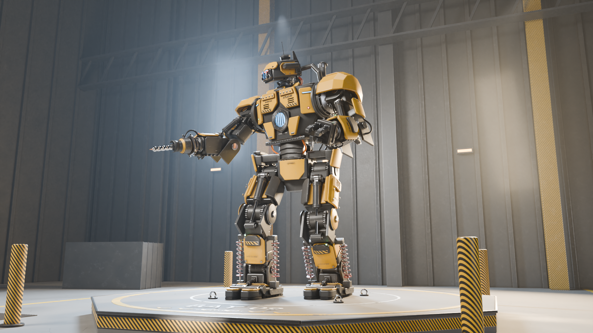
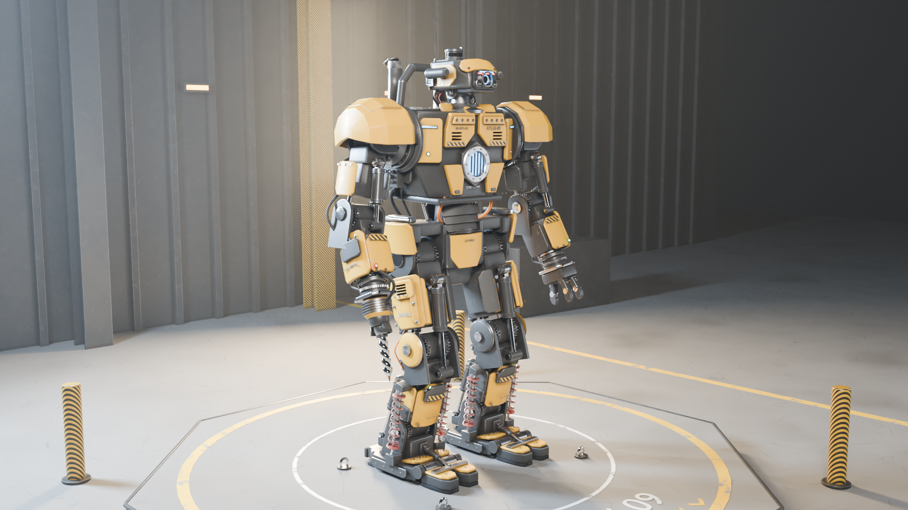
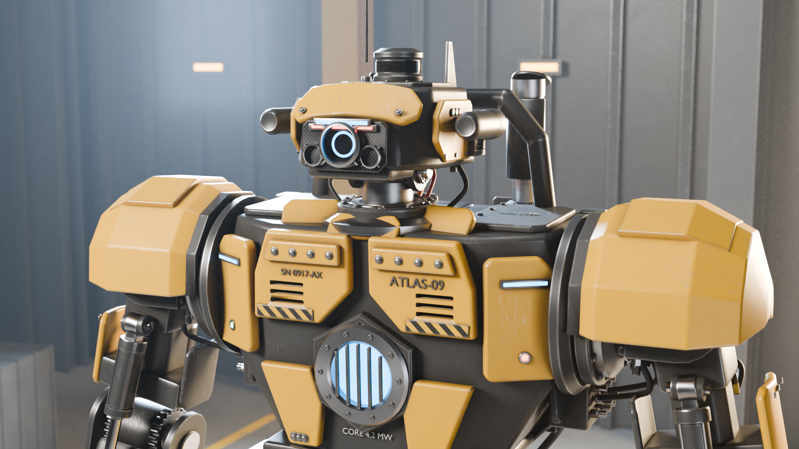
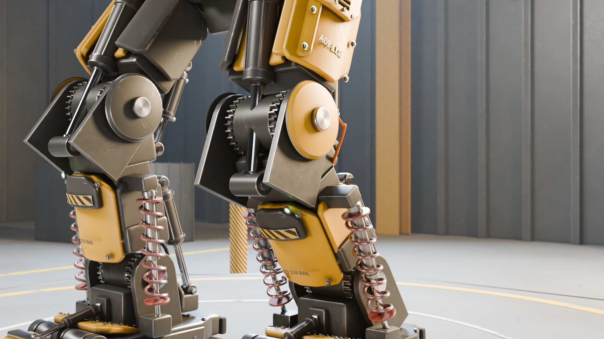
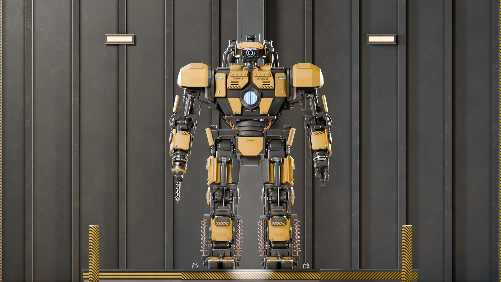
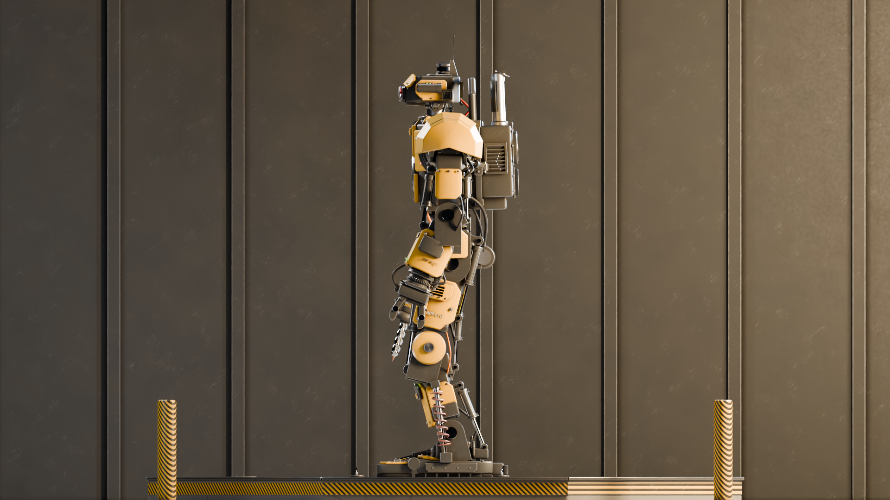
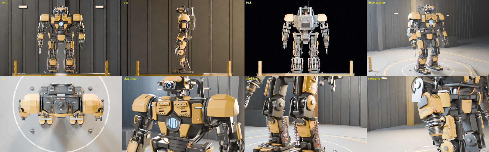

# ATLAS-09: Procedural Industrial Mech (Blender / bpy)

ATLAS-09 is a 4-metre bipedal industrial mech for heavy construction, mining and hazardous sites. It is
generated entirely from Python with Blender's API: geometry, materials, rig, poses, scene, cameras and renders.
One command rebuilds the whole project idempotently.



| | |
|---|---|
|  |  |
|  |  |
|  |  |

## Quick start

```bash
cd ATLAS-09
python3 -m venv /opt/bpyenv && /opt/bpyenv/bin/pip install bpy==5.2.2 pillow   # once
/opt/bpyenv/bin/python generate_mech.py                       # build everything, validate, save ATLAS-09.blend
/opt/bpyenv/bin/python generate_mech.py --render preview      # 640x360 previews -> renders/preview/
/opt/bpyenv/bin/python generate_mech.py --render final        # 1920x1080 finals -> renders/
/opt/bpyenv/bin/python generate_mech.py --milestone 3 --save "" --sheet renders/qc.png   # any milestone + contact sheet
# with a Blender binary instead of the pip module:
blender -b --python generate_mech.py -- --render final --samples 96
```

| Option | Meaning |
|---|---|
| `--milestone N` | Build up to milestone N (1 = blockout … 9 = everything, the default) |
| `--save PATH` | Output .blend (default `ATLAS-09.blend`; `""` = don't save) |
| `--sheet PNG` | Render the 8-view QC contact sheet (front, side, back, ¾, top, torso, legs, arm) |
| `--pose` | `Neutral` (default), `Demo` or `rest` for the saved file and the sheet |
| `--render` | `none` / `preview` / `final`; each camera renders in its own stored pose |
| `--samples`, `--only` | Override samples; render a subset of cameras (`--only cam_hero,cam_side`) |

Every run deletes the `ATLAS-09*` collections, purges orphan meshes/materials/curves/actions and then rebuilds.
Rerunning, including inside an already-generated .blend, never duplicates anything (verified, see below).
Fixed seed 9009: all procedural wear, noise offsets and per-part variation are reproducible.

## Environment and render settings

| Item | Value |
|---|---|
| Blender | `bpy` 5.2.2 LTS (pip wheel, headless). No Blender binary in the session. |
| Python | 3.13.16 |
| CPU / GPU | Intel Xeon @ 2.8 GHz, 4 cores / **no GPU** (Cycles CPU only) |
| RAM | 15 GiB |
| EEVEE | Not available headless here (`libEGL.so.1` missing). Previews also use Cycles. |
| Previews / QC | Cycles CPU, 640×360 (sheets 8×480×300), 16–32 samples, OpenImageDenoise |
| Finals | Cycles CPU, 1920×1080, **96 samples** (72 for the two depth-of-field close-ups), adaptive threshold 0.015, OIDN, AgX Medium-High Contrast |

The brief asked for 128–256 final samples. On this 4-core CPU a 1080p frame costs about 9.5 s per sample (64 samples = 907 s),
so 128 samples would take about 24 min per frame. To respect the ~20-minute CPU cap, **samples were reduced to 96 (72 for
`cam_torso_head` and `cam_leg_hydraulics`, whose depth of field costs about 25% more per sample) and resolution was kept
at 1920×1080**. Delivered frames took about 16–20 min each. Per-frame times are in `renders/timings.txt`.

## Project layout

```
ATLAS-09/
  generate_mech.py        thin entry point (argument parsing)
  mech/
    __init__.py           build pipeline, validation, report
    utils.py              collections, purge, seeding, modifiers, validated Booleans, mesh checks, connectivity
    skeleton.py           joint positions + bone hierarchy (single source of proportions)
    primitives.py         bmesh builders and parameterized generators (see below)
    parts_head.py         neck, head shell, optics, camera pods, antennas, lidar
    parts_torso.py        pelvis, waist, chest hull, armor, core, power pack, exhausts, manifolds
    parts_arms.py         shoulders, pauldrons, elbows, forearms, wrists, gripper, rock drill
    parts_legs.py         hips, thighs, hydraulic knees, shins + shocks, ankles, feet, toes
    cables.py             curve-based hose / cable routing with fittings and joint hooks
    details.py            stencil labels, LEDs, light bars, access panels
    materials.py          node-graph builder + procedural PBR recipes (and flat blockout set)
    rig.py                armature, bone parenting, hooks, Neutral/Demo actions, 2-bone leg IK, collision QC
    scene.py              platform, hangar, lights, haze, cameras, render driver
    qc.py                 contact sheets, intersection test, object/category counts
    blockout.py           milestone-1 proportion proxies
  renders/                finals, previews/, qc_m*.png milestone contact sheets
  ATLAS-09.blend          generated project
  build_report.json       last run: validation, counts, intersections, build log
  PROGRESS.md             milestone log, defect lists, failures
```

## How it is built

**Proportions first.** `skeleton.py` defines all 27 joints (hip z=2.10, knee 1.26, ankle 0.42, shoulder 3.20; head
top about 3.95 m, antennas about 4.2 m). Limb parts are modelled in a per-bone *segment frame* (origin at the joint, Z up the
limb), so posing and modelling share one coordinate system. Every object is tagged with the bone it rides on.

**Parameterized generators** (`primitives.py`) supply the scale:
- bmesh builders: chamfered box, cylinder/cone (rim-only bevel), lathe (full or partial revolve), tube, torus,
  extruded polygon with bisect loops + bend + arbitrary warp, spur gear, coil (helix sweep), beam/rod between points.
- assemblies: hex/socket/rivet **fasteners as linked duplicates** of three shared meshes, bolt rings and lines,
  **louvre vents and cooling-fin stacks with Array modifiers**, shrouded fans, slewing bearings, clevis hinges,
  geared joint drums with end caps and grease rings, **hydraulic cylinders** (clevis eye, tie rods, ports, gland,
  chrome rod), **coil-over shocks**, **weld beads (Array fit-to-curve + Curve modifier)**, bent armor plates,
  and two **Geometry Nodes** groups (`ATLAS_GN_RivetRow`, `ATLAS_GN_Tread`: instanced rivet rows and anti-slip
  lozenge tread).
- techniques: **Booleans** (thigh vent slots, chest cooling slots, fan bores) wrapped in `utils.boolean_cut`,
  which tries EXACT then FLOAT, rejects empty / volume-collapsing / non-manifold results and falls back to a simpler
  part. **Bevel** (bmesh-baked and modifier), **Weighted Normals** on hard-surface parts, **Solidify** shells
  (pauldrons, heat shields), **Subdivision Surface** on rubber pads, bumpers and grip pads, **NURBS curve** hoses.

**Hydraulics that follow the joints.** Each cylinder sits on two empties on different bones. The barrel and the rod
each carry a *Damped Track* to the other anchor, so the pair swivels and telescopes. Barrel/rod lengths are sized to
the joint's range so the rod never leaves the barrel or punches through its base. Springs use *Stretch To*. Hoses that
cross a joint get *Hook* modifiers: the far half follows the second bone and the mid point is shared.

**Materials** (`materials.py`) are node graphs. The shared painted-metal recipe combines per-part tint (Object Info
Random), Bevel-node **edge wear** to bare metal, stretched-noise **scratches**, **AO cavity grime/grease**, roughness
noise and a bump that recesses chipped paint. Other recipes: weathered yellow armor, painted industrial steel, greasy
joint steel, anisotropic **brushed titanium**, **hydraulic chrome** with oil film, dark rubber, hose rubber, HV
cable plastic, **carbon fibre** under clear coat, **emissive blue** core/optics, transmissive **glass lenses**,
thin-film coated optics, grease, heat-tinted welds, rust-spotted bolts, hazard stripes, concrete with cracks,
worn floor paint.

**Rig and poses** (`rig.py`). Armature `ATLAS-09_Rig` with 27 bones covering head yaw/pitch, lidar spin, waist twist,
chest lean, shoulder pitch, shoulder abduction, elbows, wrist rotation, hips, knees, ankles, toes, three gripper
fingers and the drill spindle. Two actions, **Neutral** and **Demo**, are stored with fake users. Leg angles come from an
analytic sagittal 2-bone IK, so both feet stay flat while the pelvis drops and a foot steps forward.
`rig.set_pose(rig, "Demo")` selects either action.

## Validation (every run)

- Mesh validity on every evaluated mesh: non-manifold edges, zero-area faces, loose geometry → **0 problems**
  across 597 meshes.
- Geometry Nodes instances must sit on their host panel (instance position inside the host's raw-mesh bounds)
  → **0 off-host instances**.
- Connectivity: AABB-touch graph flood-filled from the ground contacts (sole and toe pads) → **0 floating parts**.
- Unintended intersections: BVH triangle overlap between lower legs L/R, thighs L/R, and lower arms vs torso,
  thighs and shins, **in both Neutral and Demo** → **0 overlaps**.
- Boolean and Geometry Nodes failures are logged to `build_report.json` (and summarized in PROGRESS.md).

## Object count by subsystem

Visible, individually modelled robot objects in the final build (environment excluded). Fasteners are linked
duplicates of shared meshes and are counted separately. 73 further rivets are Geometry Nodes instances and are not
counted as objects.

| Subsystem | Structure & tools | Armor | Joints, bearings & gears | Hydraulics | Cables & hoses | Sensors & lights | Cooling & exhaust | Labels & detail | **Parts** | Fasteners | **Total** |
|---|---|---|---|---|---|---|---|---|---|---|---|
| Head | 3 | 4 | 9 | 4 | 15 | 29 | 5 | 1 | **70** | 35 | **105** |
| Torso | 11 | 19 | 24 | 16 | 30 | 9 | 20 | 16 | **145** | 128 | **273** |
| Arm L (gripper) | 19 | 9 | 21 | 20 | 12 | 1 | 0 | 4 | **86** | 64 | **150** |
| Arm R (rock drill) | 17 | 10 | 21 | 14 | 15 | 1 | 0 | 4 | **82** | 64 | **146** |
| Leg L | 19 | 22 | 31 | 37 | 12 | 1 | 1 | 7 | **130** | 93 | **223** |
| Leg R | 19 | 22 | 31 | 37 | 12 | 1 | 1 | 7 | **130** | 93 | **223** |
| **Total** | 88 | 86 | 137 | 128 | 96 | 42 | 27 | 39 | **643** | **477** | **1,120** |

Rig helpers (armature, 100 piston anchor empties, hidden weld paths and GN prototypes) and the 44-object
presentation scene are not counted above.

## Known limitations / degraded items

See the end of `PROGRESS.md` for the authoritative list. In short: final samples are reduced to 96 (CPU only);
EEVEE was unavailable, so all previews used Cycles; leg IK covers the sagittal plane only (no hip yaw/roll in the
poses); cable hooks bend hoses at a single shared midpoint rather than simulating slack.
