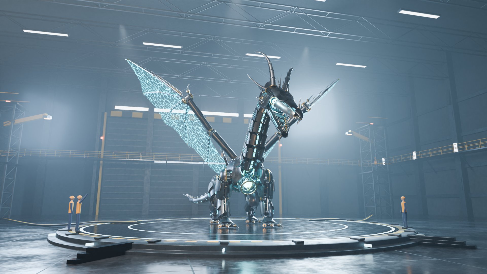
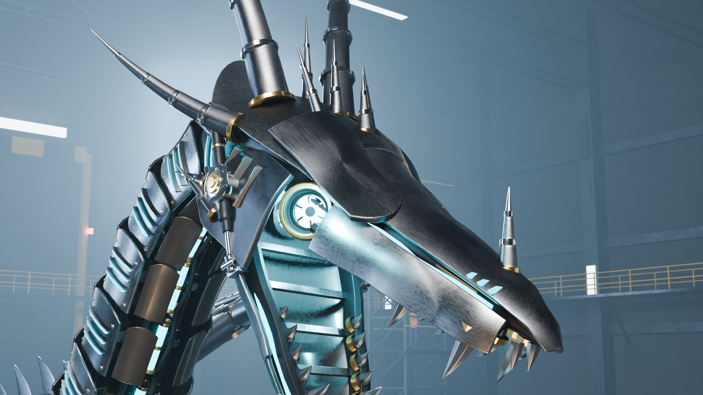
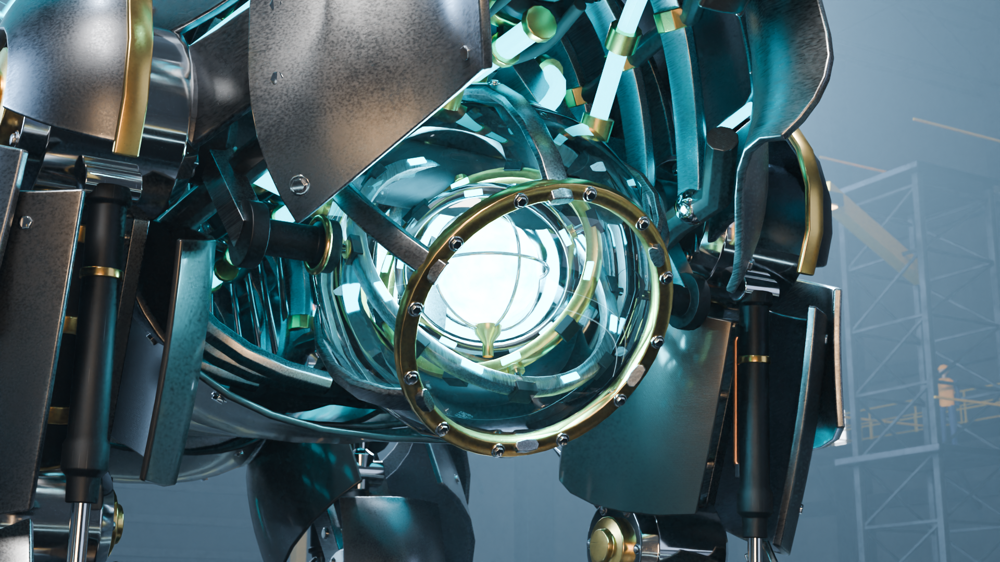
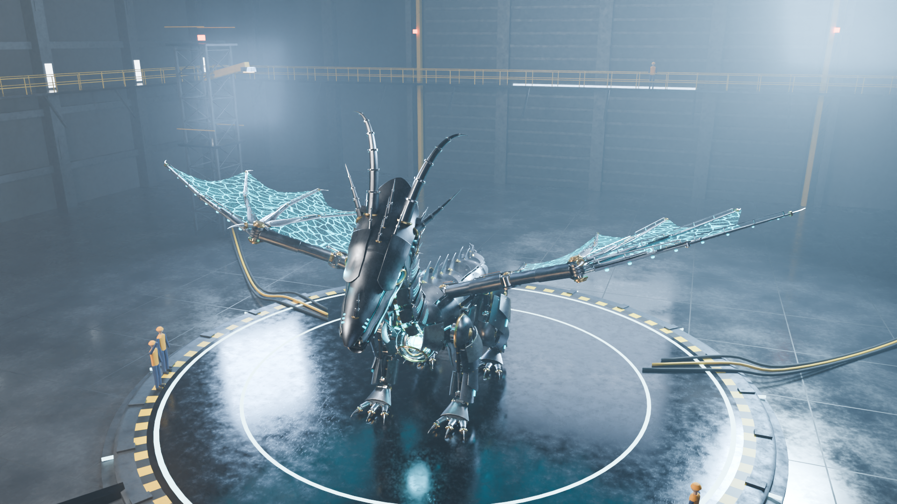

# Project AEGIS — procedural mechanical dragon

AEGIS is an original, fully procedural mechanical dragon built with Blender's Python API: about 630
rigged objects (armor plates, joints, working hydraulic pistons, a gimballed chest reactor, folding
wings with energy membranes), an 11-second activation animation, and a volumetric industrial hangar.
Nothing is hand-modelled or imported — `build.py` generates the whole scene from code in about two
seconds, and `aegis_dragon.blend` is the saved, editable result.

| | |
|---|---|
|  |  |
|  |  |

Animation: `renders/aegis_activation.mp4` (dormant → power-on → roar → wings unfold → hero pose).

## Requirements

- Python 3.13 with `pip install -r requirements.txt` (Blender 5.3 as the `bpy` module), **or** Blender 5.3+
  (`blender -b -P build.py -- --milestone 6 --save aegis_dragon.blend`).
- `ffmpeg` to assemble the animation frames.
- Rendering uses Cycles on the CPU. EEVEE was not available on the headless build machine and is untested.

## Commands

Run from this folder.

| Task | Command |
|---|---|
| Rebuild the full scene and save it | `python3 build.py --milestone 6 --save aegis_dragon.blend` |
| Build only up to a milestone (1–6) | `python3 build.py --milestone 3 --save checkpoints/m3.blend` |
| Studio preview of a milestone | `python3 preview.py 4 mytag head,chest,front34` → `previews/mytag_*.png` |
| Motion validation + pose stills | `python3 posecheck.py 1:a 142:a 264:s` (`frame:view`, views `a`, `s`, `t`) |
| Final 1080p stills | `python3 render_final.py stills [hero head reactor wings dormant]` |
| Quick 540p test of the stills | `SPP=16 python3 render_final.py test hero` |
| Animation frames (768×432) | `python3 render_final.py anim [first last]` → `renders/frames/` (resumable) |
| Encode the video | `ffmpeg -framerate 24 -i renders/frames/aegis_%04d.png -c:v libx264 -pix_fmt yuv420p -crf 16 renders/aegis_activation.mp4` |

`render_final.py` opens `aegis_dragon.blend`; set `REBUILD=1` to build from code instead. `SPP` overrides the sample count.

## Architecture

```
build.py            scene assembly by milestone; runs motion validation; saves the .blend
preview.py          neutral studio renders used to review each milestone
posecheck.py        validation report + low-res stills of chosen animation frames
render_final.py     final stills and the animation frame sequence
aegis/
  geo.py            geometry toolkit: Part (lofts, sweeps, lathes, beams, bolts, hinge joints),
                    plate() (curved armor plate), shell_fn() (overlapping/chevron plate layout)
  materials.py      procedural PBR materials and the energy drivers
  rig.py            proportions (single source of truth), armature, bone parenting, piston()
  blockout.py       milestone 1 volumes
  skeleton.py       spine, ribs, frames, limb structure, toes and claws, leg/neck/tail hydraulics
  head.py           skull core, jaw, teeth, optics, horns, facial plates, vents, wiring
  wings.py          truss booms, fan wrist hub, finger spars, membranes, retractable panels
  armor.py          torso, neck, tail and limb plates, fins, spurs, fasteners, tail blade
  reactor.py        energy sphere, gimbal rings, glass housing, support frame, conduits, lights
  animation.py      the activation sequence and validate()
  environment.py    hangar, platform, scale figures, lighting, fog volume, cameras
  render.py         Cycles settings and camera helpers
```

**How parts are made.** Every mechanical assembly is a `Part`: reusable primitives accumulate into one
multi-material mesh that gets Bevel + Weighted Normal modifiers. Every armor plate is its own object
(`plate()`): an open surface patch with Solidify + Bevel + Weighted Normal, laid out by `shell_fn()` on a
surface field (torso hull, neck/tail tube, limb, skull) so plates overlap like scales with a lifted,
pointed trailing edge. Change a number in `rig.py` (limb points, `TORSO`, `NECK`, wing layout, `HS` head
scale) and the skeleton, armor and rig all follow.

**Rigging.** Parts are rigid and bone-parented to `AEGIS_Rig` (no skin deformation), so motion respects
the hard-surface geometry. The exceptions are the wing membranes, which use an Armature modifier with
per-finger vertex groups. Each hydraulic cylinder is two objects — a barrel pinned to one bone and a
chrome rod pinned to the other, each Damped-Tracking the opposite anchor — so the rods really slide as
joints move. Feet are planted by IK (`ik_hand.*`, `ik_foot.*`), so moving `body` makes the legs flex.

**Collections.** `AEGIS` → `AEGIS_Rig`, `AEGIS_Skeleton`, `AEGIS_Hydraulics`, `AEGIS_Rig_Helpers`
(piston anchors), `AEGIS_Armor`, `AEGIS_Head`, `AEGIS_Wing_L`, `AEGIS_Wing_R`, `AEGIS_Reactor`,
`AEGIS_Energy_Lights`; plus `ENV_Hangar`, `ENV_Lights`, `ENV_Cameras`. Object prefixes: `SK_` skeleton,
`HY_` hydraulics, `AR_` armor, `HD_` head, `WG_` wing, `RX_` reactor, `ENV_`, `LGT_`, `CAM_`.

## Controls

Select `AEGIS_Rig` and enter Pose Mode. All bones use XYZ Euler rotation.

| Control | Bones | Notes |
|---|---|---|
| Body height / lean | `body` (location, X rotation) | feet stay planted through IK |
| Feet | `ik_hand.L/R`, `ik_foot.L/R` | move to re-plant a foot |
| Neck / head | `neck_01`–`neck_07`, `head` | X = pitch (negative lowers), Z = turn |
| Jaw | `jaw` | negative X opens (−36° is the roar) |
| Facial plates | `brow.L/R`, `cheek.L/R` | brow X/Y tilt, cheek Z flare |
| Tail | `tail_01`–`tail_14` | Z = sideways, X = up/down |
| Wing flap | `wing_base.L/R` X | same sign on both sides (positive raises) |
| Wing fold | `wing_arm`, `wing_fore`, `wing_f1a`–`wing_f4a`, `wing_strut` Z | mirrored sign: `.R` uses the negative of `.L`; fold angles are in `animation.FOLD` |
| Finger tips | `wing_f1b`–`wing_f4b` Z | |
| Armor panels | `wing_panel1`–`4` location Y | 0 = retracted, 1.15 = extended over the folded wing |
| Toes | `ftoe*_a/b`, `fdew_a/b`, `rtoe*_a/b`, `rdew_a/b` | |

Custom properties on the `AEGIS_Rig` object drive every emissive material and energy light:

| Property | Drives |
|---|---|
| `energy` | reactor core (with a built-in pulse), ring inlays, conduits, vents, core light |
| `eye_power` | optics and eye lights |
| `throat_power` | throat emitter and light |
| `membrane_power` | wing membranes (0 = fully transparent) |

The reactor rings (`RX_ring_outer` → `RX_ring_mid` → `RX_ring_inner`) are a nested gimbal; each is
keyframed on one axis.

## Animation timeline (24 fps, frames 1–264)

| Frames | Event |
|---|---|
| 1–30 | dormant: crouched, head lowered, wings folded under their panels, tail curled, all energy off |
| 30–50 | eyes flicker on |
| 40–96 | reactor ramps up, rings spin up, conduits light |
| 56–125 | neck rises segment by segment, body stands up |
| 116–156 | jaw opens for the roar, cheek and brow plates flare, throat glows |
| 100–216 | wings unfold: flap up, shoulder sweep, elbow, finger fan; panels retract |
| 180–216 | membranes ignite |
| 110–264 | tail travelling wave |
| 216–264 | wings flare into the hero pose |

`CAM_cinematic` is the animated camera; `CAM_hero`, `CAM_head`, `CAM_reactor`, `CAM_wings` are the stills.

## Validation

`build.py` (milestone ≥ 5) and `posecheck.py` evaluate the animation every 4 frames and report:

- each of the 58 pistons' stroke against the travel its barrel and rod allow,
- foot slip (distance between each leg chain and its IK target),
- the lowest point reached by any neck, head, tail or wing bone (ground clearance).

Current result: 0 pistons out of stroke, 0.0000 m foot slip, 0.46 m minimum clearance — PASS.

Milestone review renders are in `previews/` (`m1_*` blockout, `m2_*` skeleton, `m3_*`/`m3b_*` armor and
head, `m4_*` reactor, `pose_*` animation frames) and the matching scenes in `checkpoints/m1–m5.blend`.

## Known limitations

- There is no automatic mesh-intersection test. Clearances were checked by eye in renders; some
  overlap is intentional (piston rods inside barrels, overlapping armor scales) and close-packed parts
  such as the folded finger bundle may touch.
- Wing membranes are treated as projected energy fields: they are switched off while the wing is folded
  rather than being simulated as folding cloth.
- The `chest` bone exists for structure but is not animated; the torso hull is rigid.
- The animation was rendered at 768×432 with 12 samples and denoising to fit a 4-core CPU budget, so it
  is softer than the 1080p stills. `render_final.py anim` can re-render at any size.
- Scale figures and hangar props are deliberately simple; modelling effort went into the dragon.
