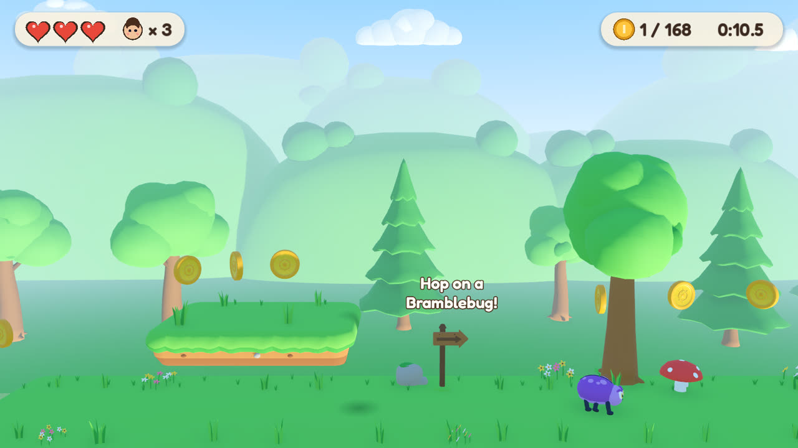

# Brightmeadow — Juni's Trail

An original 2.5D side-scrolling platformer. Guide Juni, a young explorer with a teal jacket,
an orange backpack and enormous boots, across a sunny meadow: run, jump, bop Bramblebugs and
Buzzpuffs, collect coins, raise checkpoint flags and reach the finish arch.

- **Engine:** Godot 4.5.1 (GDScript, Forward+ renderer, Jolt physics)
- **Art:** every model, rig and animation generated by Blender 4.5 LTS Python scripts
  (`assets/blender/`) and exported as glTF 2.0 (`.glb`)
- **Audio:** all sound effects and music synthesised by `assets/audio/synth_audio.py`
- **Font:** Fredoka, SIL Open Font License (`game/assets/fonts/OFL.txt`)
- **Target:** macOS desktop (developed and validated on Linux; see "What was tested")



## Play on macOS

**Option A — open the project (recommended):**
1. Install Godot **4.5.1** (standard, not .NET) from <https://godotengine.org/download/archive/>
   and move `Godot.app` to `/Applications`.
2. Open Godot → **Import** → choose `Brightmeadow/game/project.godot` → **Import & Edit**.
   The first import takes a minute.
3. Press **F5** (or the ▶ Play button).

From a terminal instead: `/Applications/Godot.app/Contents/MacOS/Godot --path Brightmeadow/game`

**Option B — export a standalone app:**
1. In the editor: **Editor → Manage Export Templates → Download and Install** (4.5.1).
2. **Project → Export → macOS → Export Project** (preset already configured: universal binary,
   ad-hoc signed, not notarized). Or run `scripts/export.sh macos` with `GODOT` pointing at
   `/Applications/Godot.app/Contents/MacOS/Godot`.
3. Unzip and open `Brightmeadow.app`. Because it isn't notarized, macOS Gatekeeper blocks the
   first launch: right-click → **Open** → **Open**, or run
   `xattr -dr com.apple.quarantine Brightmeadow.app`. Distributing it to others needs an Apple
   Developer ID for signing and notarization.

## Controls

| Action | Keys |
|---|---|
| Walk | `A` / `D` or `←` / `→` |
| Run | hold `Shift` |
| Jump (hold for higher) | `Space` (also `W`, `↑`, `Z`) |
| Pause | `Esc` or `P` |
| Restart level | `R` |
| Fullscreen / mute | `F` / `M` |

Gamepads work too. Full table and rules: `docs/CONTROLS.md`.

## Develop on Linux

```bash
cd Brightmeadow
scripts/setup_linux.sh            # Godot 4.5.1 + Python 3.11 venv with bpy 4.5.15 (Blender) + numpy
scripts/validate.sh               # everything automated (see below)
source scripts/env.sh && $GODOT --path game     # play (needs a display)
```

`setup_linux.sh` is idempotent and verifies the Godot download against the official SHA-512 sums.
Add `--templates` to install export templates (~1 GB). It installs Xvfb/Mesa/ffmpeg via apt when
run as root.

| Tool | Version | Source |
|---|---|---|
| Godot | 4.5.1-stable | github.com/godotengine/godot releases (SHA-512 verified) |
| Blender | 4.5.15 LTS as the `bpy` Python module | PyPI `bpy==4.5.15` (official Blender build) |
| Python | 3.11 (via `uv`) | python-build-standalone |
| numpy | 1.26.4 | PyPI |
| ffmpeg | distro (6.1) | apt — used to encode the music to Ogg Vorbis |

## Regenerate assets

```bash
scripts/generate_models.sh          # all GLBs into game/assets/models (+ --render for previews)
scripts/generate_audio.sh           # all audio into game/assets/audio
```

On macOS with Blender 4.5 installed, the same generators run in the real Blender:
`BLENDER=/Applications/Blender.app/Contents/MacOS/Blender scripts/generate_models.sh`.
Details: `docs/ART_PIPELINE.md`, `docs/AUDIO.md`. Both generators are deterministic.

## Tests and validation

`scripts/validate.sh` runs, in order: the GLB contract checker, the audio checker, a Godot
headless import (fails on script/import errors), the Godot test suite, and a 300-frame boot of
the main scene. Tests (`game/tests/`):

- **unit** — movement math, coyote time, jump buffer, session rules, level parsing;
- **feasibility** — every surface reachable from the start, goal reachable from everywhere, no
  running jumps before the run tutorial, coins reachable, enemies clear of respawn points;
- **smoke** — on the real level scene with physics: walking, jump height vs model, short hop,
  coin pickup, checkpoint + respawn, side damage + invulnerability, stomping both enemies,
  jumping up through platforms, losing a life, game over, finishing, pause;
- **autoplay** — a bot plays the whole level through the real controller and must finish
  without falling;
- **integrity** — all scenes/scripts load, every contracted model/animation/sound is present.

`scripts/screenshots.sh` renders real Forward+ screenshots (software Vulkan under Xvfb).

## Project layout

See `docs/ARCHITECTURE.md`. In short: `game/` is the Godot project, `assets/` the generators,
`scripts/` the tooling, `docs/` the documentation (including `PROGRESS.md`, the phase log).

## What was tested

Automated on Linux (Ubuntu 24.04, no GPU): asset contract checks (252/252), audio checks, clean
Godot import, 61/61 Godot tests including an autoplay bot that finishes the level through the
real controller and physics, a clean main-scene boot, and macOS + Linux exports (the Linux build
boots). Screenshots were rendered with the real Forward+ renderer in software and inspected
(`docs/images/`).

**Not tested:** running on a Mac, frame rate on real GPU hardware, listening to the audio (no
sound device; levels and loop seams were checked numerically), and human playtesting of feel and
difficulty. The 3–5 minute play-time target is a design estimate. Phase-by-phase evidence and
known limitations are in `docs/PROGRESS.md`.
