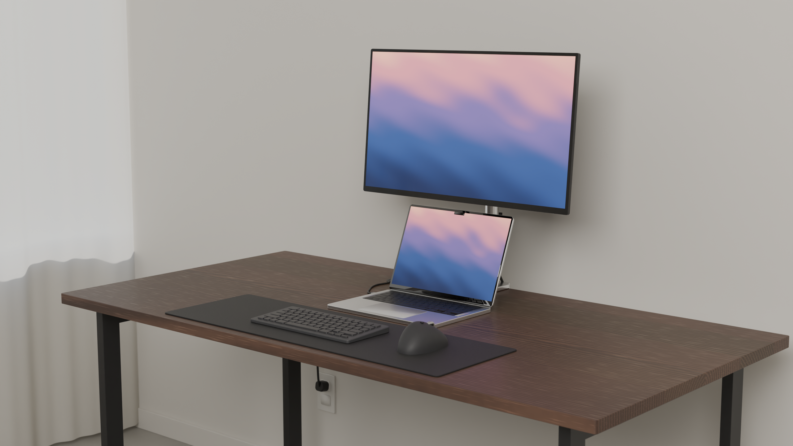
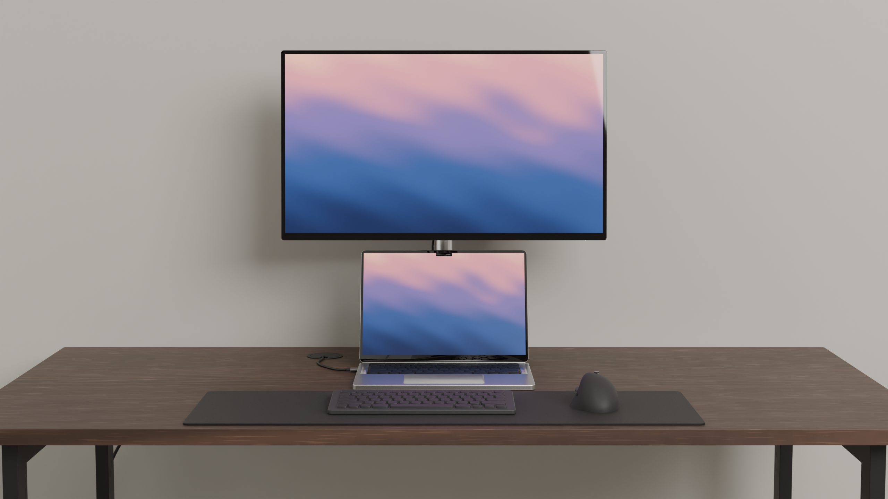
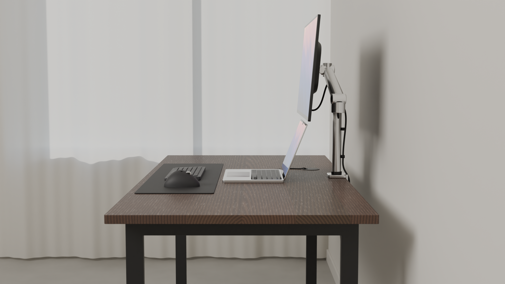
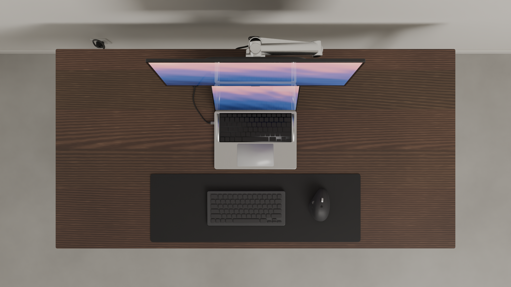

# DeskSetup

A photorealistic, minimalist workstation generated entirely with Blender's Python API and rendered
in Cycles. One script builds the room, the desk and every device from real-world dimensions, solves
an ergonomic layout, renders four product-photography views and saves the `.blend` project.



| Front | Side |
|---|---|
|  |  |
| **Overhead** | **Three-quarter** |
|  |  |

## What is in the scene

All sizes are real-world, in millimetres unless noted.

| Component | Model | Key dimensions |
|---|---|---|
| Desk | Glued-up oiled walnut slab on two black powder-coated steel loop legs, rear stretcher, levelling glides | 60 × 30 in top (1524 × 762), 1 in thick, 29 in high; 25 × 50 tube |
| Monitor | 27 in 16:9, thin bezels, slim chin, tapered rear housing, VESA 100 | 597.7 × 336.2 active area |
| Monitor arm | C-clamp, pole, horizontal lower arm, gas-spring upper arm, swivel/tilt head, VESA plate, cable cover and clips | 200 mm lower arm, 225 mm gas arm |
| Laptop | 14 in MacBook Pro proportions (no logos): unibody base, keyboard well, speaker grilles, glass trackpad, hinged lid with camera notch | 312.6 × 221.2 × 15.5 |
| Keyboard | Compact low-profile wireless, Logitech MX Keys Mini proportions, wedge body, 80 keycaps | 296 × 132 |
| Mouse | Right-handed ergonomic, MX Master proportions: sculpted shell, knurled steel wheel, thumb rest, thumb wheel and buttons | 124.9 × 84.3 × 51 |
| Desk mat | Black PU leather with pebble grain | 800 × 260 × 3 |
| Cable management | Desk grommet, under-desk steel tray, hidden USB-C dock and power strip, wall outlet, 5 routed cables with modelled plugs | |
| Room | Microcement floor, painted walls and baseboards, black-framed window with float glass, linen curtain | |

Cables are hidden from the front view: the laptop's USB-C cable drops through the grommet into the
tray; the monitor's data and power cables run along the underside of the arm, down the pole, over the
back edge and into the tray; the mains lead drops behind the left leg to the wall outlet.

Every material is procedural (no image files): walnut with per-board ring figure, pores and glue
lines; bead-blasted, brushed and black anodised aluminium; float glass and display cover glass;
matte ABS, soft-touch and keycap plastics; powder coat, rubber, PU leather, cable jackets, wall
paint, microcement and linen. The screens show a procedural wallpaper as emission under a glossy
coat, so they reflect the room like real displays.

## Requirements

- Python 3.13 with the `bpy` module (Blender 5.2 as a Python package):

  ```bash
  python3.13 -m venv .venv
  .venv/bin/pip install bpy==5.2.2 pytest
  ```

- or Blender 5.2 itself (it ships its own Python and `bpy`).

## Usage

Run from this `DeskSetup/` folder:

```bash
.venv/bin/python build.py                                # full quality, all four views -> output/
.venv/bin/python build.py --preview --views front        # 960x540, 48 samples, one view
.venv/bin/python build.py --config config/standing_desk.json --out output/standing
.venv/bin/python build.py --no-render                    # only build and save the .blend
.venv/bin/python build.py --resolution 3840x2160 --samples 256

blender --background --python build.py -- --preview      # same, inside the Blender app
```

Outputs in `output/`:

- `DeskSetup.blend`: the full project. Open it in Blender to keep working. Each component is a
  parented object tree in its own collection, and the config and layout report are embedded as
  text blocks.
- `desk_front.png`, `desk_side.png`, `desk_overhead.png`, `desk_three_quarter.png`: 2560 × 1440 renders.
- `layout_report.json`: the ergonomic numbers for the solved layout.

At the default 128 samples with OpenImageDenoise, a 2560 × 1440 view takes about 30 minutes on a
4-core CPU (Cycles CPU). `--preview` takes about a minute per view.

## Configuration

All settings live in `desksetup/config.py` as dataclasses with units in their names (`width_in`,
`face_from_back_edge_mm`, `tilt_deg`). A JSON file overrides any subset; unknown keys are rejected so
typos fail loudly. Cameras merge by name: a known name updates that camera, a new name adds one.

```json
{
  "desk": {"width_in": 72, "depth_in": 30, "height_in": 29},
  "monitor": {"bottom_above_desk_mm": 260, "tilt_deg": 8, "face_from_back_edge_mm": 150},
  "keyboard": {"x_mm": -60},
  "arm": {"finish": "black"},
  "laptop": {"finish": "space_gray", "lid_angle_deg": 110},
  "cameras": [{"name": "wide", "location_mm": [-1600, -2600, 1500], "target_mm": [0, 0, 900], "lens_mm": 35}]
}
```

Examples in `config/`: `default.json`, `large_desk_black_arm.json`, `standing_desk.json`.

Common settings:

| Section | Setting | Default | Notes |
|---|---|---|---|
| `desk` | `width_in`, `depth_in`, `height_in` | 60, 30, 29 | |
| `monitor` | `bottom_above_desk_mm` | `null` (solved) | height of the housing's lower edge |
| `monitor` | `tilt_deg` | `null` (solved) | backward tilt; solved to face the eyes |
| `monitor` | `face_from_back_edge_mm`, `x_mm` | 150, 0 | |
| `arm` | `pole_height_mm` | `null` (solved) | pole is sized so the arm reaches the monitor |
| `laptop` | `lid_angle_deg`, `x_mm`, `gap_behind_mat_mm` | 112, 0, 18 | |
| `keyboard` / `mouse` | `x_mm`, `rotation_deg`, `gap_from_keyboard_mm` | | |
| `ergonomics` | `eye_height_mm`, `lid_clearance_mm` | 1215, 18 | seated eye height above the floor |
| `lighting` | `sun_elevation_deg`, `sun_azimuth_deg`, `exposure` | 32, 200, 0.7 | |
| `render` | `resolution_x/y`, `samples` | 2560 × 1440, 128 | |

## Ergonomic layout solver

`desksetup/layout.py` is pure Python (no Blender) and turns the config into positions:

1. Mat, keyboard and mouse at the front edge; laptop behind the mat; open-lid geometry from the
   hinge angle.
2. Monitor raised until its housing clears the lid by `lid_clearance_mm` **and** the user's line
   of sight over the lid lands below the visible screen. It stays centred over the laptop.
3. Monitor tilted so the screen faces the eyes.
4. Two-link arm solved between the clamp and the VESA head. The lower arm swings horizontally and
   the gas arm keeps its length, so the elbow folds out of sight behind the monitor.
5. Bounding-box check of every component pair. Overlaps or an unreachable monitor raise
   `LayoutError` before Blender is touched. Ergonomic concerns become warnings.

Default report: 775 mm viewing distance, screen centre 4.9° below eye level, 18 mm lid clearance,
keyboard 89 mm from the desk edge. Stacking a monitor above an open laptop puts the top of the
screen about 100 mm above seated eye level. That is the accepted trade-off of this layout, and the
report shows it.

## Project structure

```
DeskSetup/
├── build.py                    CLI: build, render, save
├── config/                     example JSON overrides
├── desksetup/
│   ├── config.py               dataclass settings + JSON loading        (pure Python)
│   ├── layout.py               ergonomic solver + overlap checks         (pure Python)
│   ├── geometry.py             bmesh helpers (mm in, metres out), bevels, curves
│   ├── materials.py            procedural PBR material library
│   ├── lighting.py             sky, sun, window portal, fill; AgX colour management
│   ├── cameras.py              front / side / overhead / three-quarter cameras
│   ├── render.py               Cycles settings, PNG export, .blend save
│   ├── scene.py                orchestration
│   └── components/             one module per reusable component
│       desk.py  desk_mat.py  monitor.py  monitor_arm.py  laptop.py  keyboard.py  keys.py
│       mouse.py  dock.py  cable_management.py  room.py
├── tests/                      pytest: config, layout, and a bpy scene build
└── output/                     renders, .blend and layout report
```

Each component's `build(cfg, layout, collection)` takes its dimensions from the config and its
position from the solved layout, so it can be reused in other scenes. `dock.build_dock` and
`dock.build_power_strip` take only a collection and a position.

## Tests

```bash
.venv/bin/python -m pytest          # 37 tests; the bpy scene tests are skipped when bpy is missing
```

## Notes

- No brand names or logos are modelled. "MacBook", "Logitech" and "MX" only describe the reference
  proportions.
- Key legends are not modelled. They would not be readable at these camera distances.
- Rendering uses the CPU. For a GPU, set `scene.cycles.device = "GPU"` after enabling a device in
  Blender's preferences.
