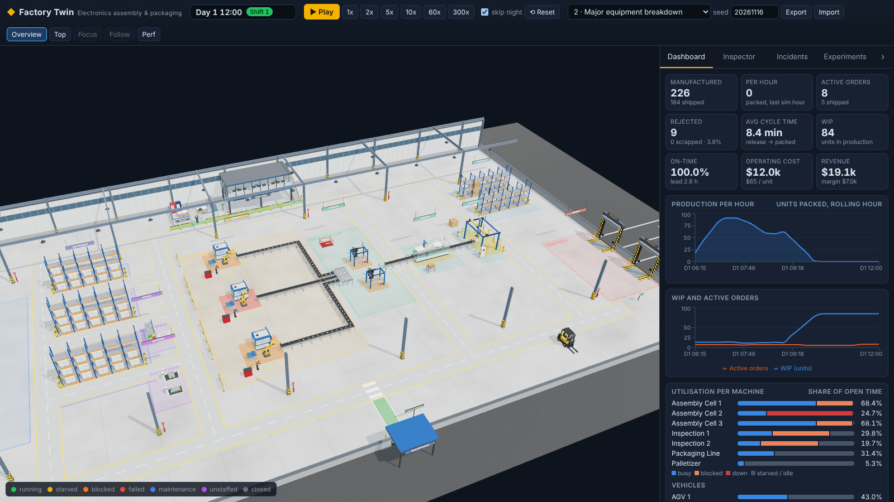
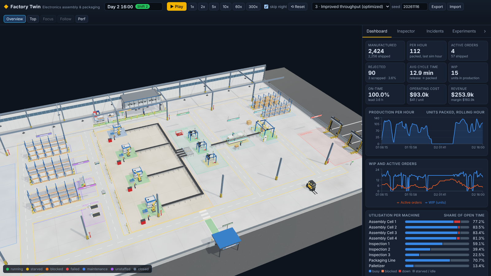

# Factory Twin

An interactive 3D digital twin of an electronics assembly and packaging plant. It makes a
smart-home sensor hub (A) and a wireless speaker (B). A deterministic discrete-event simulation
drives everything you see. Robot arms, belts, gantries, AGVs, the forklift, workers, products,
pallets and trucks are all drawn from simulation state at render time; nothing moves on a
scripted timeline.


## Install and run

Requires Node 20+ (developed on Node 22) and a WebGL2 browser.

```bash
cd FactoryTwin
npm install
npm run dev          # http://localhost:5173
```

URL options for demos and screenshots:

| Parameter | Effect |
|---|---|
| `?scenario=normal \| breakdown \| optimized` | Load one of the three one-click scenarios |
| `&t=9.5` | Fast-forward to 9.5 simulated hours before rendering |
| `&paused=1` | Start paused |
| `&speed=10` | Start at this playback speed |
| `&select=station:cell-1` | Pre-select an entity (`product:P400`, `vehicle:agv-0`, `worker:W1-03`, …) |
| `&cam=focus` | Camera mode: `orbit`, `top`, `focus` or `follow` |
| `&tab=dashboard` | Open a side-panel tab |
| `&perf=1` | Show the performance monitor |
| `&worker=1` | Run the engine in a Web Worker instead of the main thread |

## Controls

| Action | How |
|---|---|
| Orbit, pan, zoom | Left-drag, right-drag, scroll |
| Overview, top-down, focus, follow | Top-bar camera buttons (focus and follow need a selection) |
| Inspect | Click any machine, conveyor, worker, AGV, forklift, product, pallet or rack. Hover shows a tooltip; the selection gets a ring and a beam |
| Playback | Play/Pause; 1x, 2x, 5x, 10x (plus 60x and 300x); *skip night* fast-forwards 22:00 to 06:00; Reset |
| Scenarios | Pick 1 · Normal, 2 · Breakdown or 3 · Optimized; set a seed and press Enter; Export or Import scenario JSON |
| Incidents tab | Inject any of 8 incidents, see the incident timeline, and apply recovery (repair now, reroute, reassign worker, expedite materials) |
| Experiments tab | Edit parameters, save a baseline, compare over N seeds (mean ± std), run the optimizer |

Machine state shows on each station's stack light and as a coloured floor halo: green running,
amber starved, orange blocked, red failed (pulsing), blue maintenance, purple unstaffed, grey closed.

## The three scenarios (numbers from the simulation)

Full tables are in [docs/scenario-results.md](docs/scenario-results.md), produced by `npm run report`.
Each side uses the same 3 seeds; values are mean ± std.

| Scenario | Baseline | Changed | Result |
|---|---|---|---|
| **1 · Normal operation** (5 days) | — | default plant | 1,145 ± 56 units shipped/day, 99.0% on time, $39.2 per unit; assembly is the bottleneck in every seed |
| **2 · Major equipment breakdown** (Cell 2 down 10 h, belt C2 down 90 min) | normal, day 1: 1,000 units, $71.3k/day | breakdown, day 1: 672 units, $43.2k/day | **−32.9 % throughput, −39.3 % objective** on day 1; over 3 days the gap narrows to −8.1 % as the backlog is worked off |
| **3 · Improved throughput after optimization** (growth demand +25 %, 5 days) | 1,219 ± 50 units/day, 237 order-hours late | optimizer's #1 setting: 1,441 ± 115 units/day, 0 h late | **+18.2 % throughput, +19.0 % objective**, cost per unit flat |

Over 30 days the default plant runs assembly at 91–93 %, inspection at 50–51 % and packaging at
66–69 % (`npm run calibrate`). Short runs read lower because the line is still filling.

| Normal | Breakdown | Optimized |
|---|---|---|
|  |  |  |

More screenshots: [selected machine](docs/selected-machine.png), [product lifecycle](docs/product-lifecycle.png),
[failure state](docs/failure-state.png), [dashboard](docs/dashboard.png), [top view](docs/top-view.png),
[experiments](docs/experiments.png).

## Architecture

```
src/simulation    engine (event heap, (time, class, seq) ordering), seeded PRNG streams, rolling log hash, host API, headless runner
src/entities      records (product, order, pallet), state / queue / wear trackers
src/production    factory model: orders, assembly cells, conveyors, inspection, packaging, palletizer,
                  workforce, incidents, metrics, bottleneck detector, invariants
src/logistics     layout, waypoint graph, motion segments, inventory & suppliers, AGVs/forklift, shipping
src/optimization  parameter space, multi-seed evaluation, comparison, hill-climbing optimizer
src/scenarios     default scenario (documented calibration), presets, JSON import/export
src/rendering     R3F scene: procedural models, environment, layers that read snapshots in useFrame
src/components    app shell, inspector, incidents, experiments      src/dashboard  KPIs and charts
src/workers       Web Workers: simulation host, optimizer
```

- **Purity.** The five simulation folders import nothing from React, three or the DOM, and never
  call `Math.random` or `Date.now`. A test enforces this.
- **Time.** Simulation time advances only when events are processed. The playback controller picks
  a target time each frame (speed × frame time, capped at 120 sim-seconds and 5,000 events). The
  renderer evaluates motion segments and phase progress at that time.
- **Determinism.** Each concern has its own mulberry32 stream (`arrivals`, `quality`,
  `absence`, `supply`, `carrier`, `proc:<station>`, `fail:<resource>`). Injected user events
  always sort after model events at the same time, so a recorded scenario replays to an
  identical event log.
- **UI state.** Zustand holds only UI state plus dashboard samples, refreshed at 4 Hz. Scene
  components read `runtime.current` inside `useFrame`.
- **Performance.** The default scene draws about 280 calls including shadows (budget 400) and
  about 570k triangles. Products, pallets, cartons, rollers, rack parts and markings are
  instanced, and geometries and materials are shared.

See [SPEC.md](SPEC.md), [ARCHITECTURE.md](ARCHITECTURE.md), [DECISIONS.md](DECISIONS.md) (34
decisions), [TEST_PLAN.md](TEST_PLAN.md) and [TASKS.md](TASKS.md).

## Tests

```bash
npm test               # 91 Vitest tests, headless, ~25 s
npm run check:30day    # 30 simulated days: ~2.3 s, 744k events, all invariants hold
npm run test:e2e       # 5 Playwright smoke tests on the production build (SwiftShader WebGL)
npm run calibrate      # utilisation per stage, 30 days
npm run report         # scenario comparison + optimizer → docs/scenario-results.md
npx vite preview --port 4173 & npm run screenshots   # docs/*.png
```

The Vitest suites cover all 10 required invariants (see TEST_PLAN.md). They also check unit
and material conservation, conveyor spacing, a different seed giving a different hash,
snapshots free of NaN or Infinity, scenario replay, every incident type, workforce coverage,
the optimizer, and module purity.

## Final report

See [FINAL_REPORT.md](FINAL_REPORT.md).
