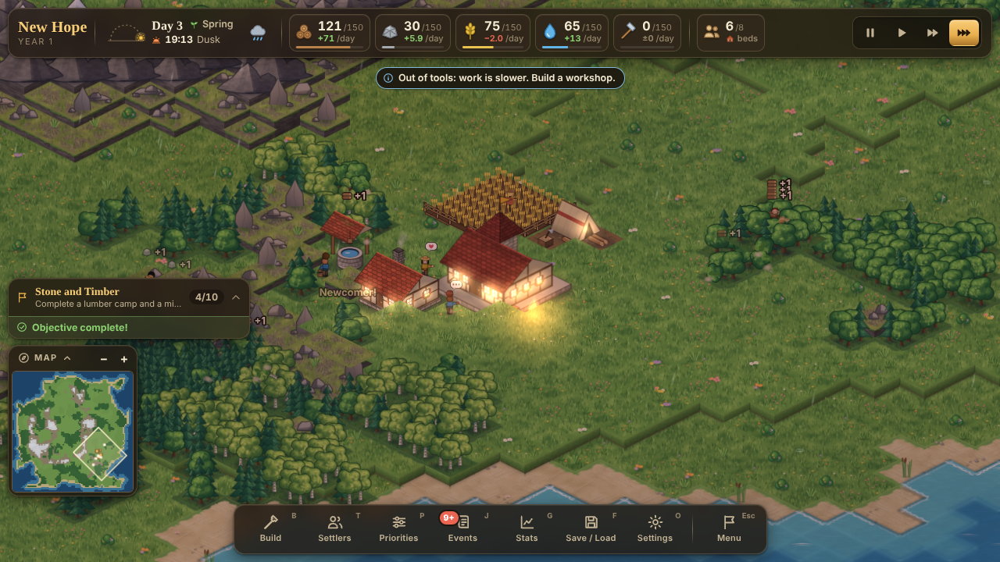

# Frontier Colony

An isometric colony simulator that runs in the browser. Five settlers arrive on a procedurally generated
frontier. They eat, sleep, chop, quarry, farm, haul and build on their own. You decide what gets built and
where, set job priorities, and steer the colony through weather, random events and its first winter.

TypeScript · React 19 · PixiJS 8 · Zustand 5 · Vite 8 · Vitest · Playwright. No backend: games are saved
in the browser's localStorage. All art is procedural (drawn in code at startup), so there are no asset files.



## Run it

Requires Node.js 22.12 or newer (Vitest 5 and Vite 8 need it) and npm.

```bash
cd FrontierColony
npm install
npm run dev          # http://localhost:5173
```

Production build:

```bash
npm run build        # typecheck + bundle to dist/
npm run preview      # serve dist/ at http://localhost:4173
```

URL options: `?quickstart` skips the menu and starts a default colony (add `&seed=…&preset=…&size=…&difficulty=…`
to choose), and `?debug` exposes the game controller as `window.__frontierColony` in a production build.

## How to play

1. **Found a colony.** Pick a name, a seed (same seed, same world), a landscape (Continent, Archipelago,
   Highlands, River Valley), a map size and a difficulty. A short guided tour runs on your first game; replay it
   from Settings, or open **How to Play** (`H`) any time.
2. **Build.** Open the Build panel (`B`), choose a building and click the map. A ghost shows whether the spot is
   valid and why not. Placing reserves the materials; settlers haul them to the site and build it.
   Start with a **Farm**, a **Well** and a **House** near the Town Center, then a **Lumber Camp** by a forest and
   a **Mine** by the hills. **Storage** and the **Workshop** (which makes tools) unlock through objectives.
3. **Steer, don't micromanage.** Settlers pick their own work from what the colony needs. Use **Priorities**
   (`P`) to raise or switch off whole job categories (building, farming, woodcutting, mining, water, hauling,
   crafting).
4. **Keep them alive.** Each settler has hunger, energy, happiness and health. They eat food and drink water from
   the stores, sleep at night (in a bed if one is free), and get unhappy when overworked, homeless, cold or
   grieving. Watch the warnings strip under the top bar: it forecasts shortages in days before they hurt.
5. **Prepare for winter.** Seasons last 5 days. In winter farms lie fallow and snow slows everything, so fill
   the larder in autumn.
6. **React to events.** Traders, wanderers asking to join, a harvest festival (decisions you accept or decline),
   plus wolves, sickness, droughts, wildfires, storms that damage buildings, rich veins and more.
7. **Win or lose.** Reach 20 settlers with decent morale after surviving the first winter to earn the
   "Thriving Frontier" victory (you can keep playing afterwards). If every settler dies, the colony is lost.

### Controls

| Input | Action |
|---|---|
| Drag (any mouse button), WASD / arrow keys | Pan the camera |
| Mouse wheel, pinch, minimap `+`/`−` | Zoom (anchored at the cursor) |
| Left-click | Select a settler, building or tile |
| Right-click / `Esc` | Cancel placement, close a panel, clear the selection, then open the game menu |
| `Space` | Pause / resume |
| `1` `2` `3` | Speed 1x / 2x / 4x |
| `B` `T` `P` `J` `G` `F` `O` `H` | Build, Settlers, Priorities, Events log, Stats, Save/Load, Settings, How to Play |
| `Shift`+`1`…`7` | Pick a building while the Build panel is open |
| Click the minimap | Jump the camera there |

### Saving

Use **Save / Load** (`F`) for three manual slots. The game also autosaves at the start of each day and when
you close the tab (turn this off in Settings). Saves are versioned and validated on load. A corrupt or
incompatible save shows an error instead of crashing.

## Project layout

```
src/sim/      pure, deterministic simulation (no DOM): world generation, settlers, economy, events
src/render/   PixiJS renderer: procedural textures, chunked terrain, settlers, buildings, effects, camera
src/ui/       React HUD, panels, menus, minimap, tour
src/store/    Zustand UI store and the throttled HUD snapshot
src/game/     GameController: fixed-timestep loop, commands, save/load
tests/        Vitest unit, balance and soak tests      e2e/   Playwright browser tests
docs/         GAME_DESIGN.md (all gameplay numbers), balance/, reviews/, screenshots/
```

Architecture, contracts and rules are in [`CLAUDE.md`](CLAUDE.md) and [`SPEC.md`](SPEC.md). Milestones and
team are in [`PLAN.md`](PLAN.md), status in [`PROGRESS.md`](PROGRESS.md), and the multi-agent model evaluation
in [`BENCHMARK.md`](BENCHMARK.md).

## Tests

```bash
npm run typecheck
npm test             # Vitest: sim, balance soaks, save/load, store, UI logic, render logic
npm run test:e2e     # Playwright (Chromium): builds to dist-e2e/ and drives the real game
```

The e2e suite uses Playwright 1.56.1 and expects its Chromium to be installed (`npx playwright install chromium`
on a fresh machine). It runs WebGL through software rendering (SwiftShader), so it is slow; allow several minutes.
