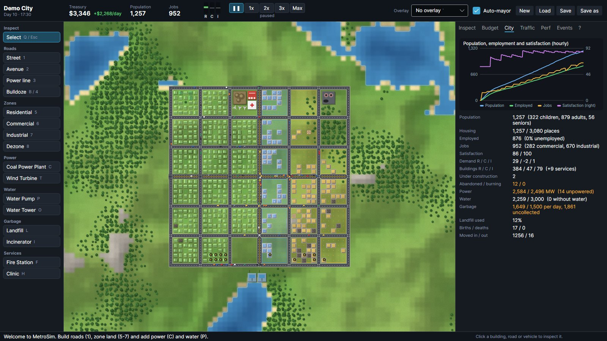

# MetroSim

A city-building simulation inspired by Cities: Skylines, written in C# on .NET 10. Interlocking systems
produce observable consequences: zoned land grows into buildings when there is demand; citizens commute
along A*-routed roads; congestion emerges from lane capacity and intersection limits; and the budget,
utilities and services decide whether the city thrives or empties out.

- **Deterministic, headless core** (`MetroSim.Core`, no dependencies): the same seed and the same player
  commands always produce the same city, bit for bit, including after any save/load.
- **Desktop app** (`MetroSim.App`, Avalonia 12 + SkiaSharp) for Windows, macOS and Linux.
- **SQLite save files** with versioned chunks, per-chunk SHA-256 and a whole-state fingerprint.
- **CLI** (`MetroSim.Cli`) for headless runs, save verification by replay, and benchmarks.

See `docs/ARCHITECTURE.md` for the design, `docs/BENCHMARKS.md` for performance, `PROGRESS.md` for the
build log.

## Build and run

Requirements: .NET SDK 10.0 (tested with 10.0.113). From this folder:

```bash
dotnet build                                   # everything (warnings are errors)
dotnet run --project src/MetroSim.App          # play
dotnet run --project src/MetroSim.App -- --seed 1234
dotnet run --project src/MetroSim.App -- --load ~/my.city
dotnet test                                    # all tests
```

On Linux without a display, the app runs under `xvfb-run -a`. The UI tests need no display: they use
Avalonia's headless platform with real Skia rendering.

### Headless CLI

```bash
cd src/MetroSim.Cli
dotnet run -c Release -- demo --days 30                      # scripted demo city, daily report
dotnet run -c Release -- demo --size 192 --blocks 12 --days 90 --save big.city
dotnet run -c Release -- run --load big.city --days 10       # continue a save headlessly
dotnet run -c Release -- verify big.city                     # integrity checks + replay from seed
dotnet run -c Release -- new --out empty.city --seed 7 --size 128
dotnet run -c Release -- bench --out ../../docs/BENCHMARKS.raw.md
dotnet run -c Release -- profile --citizens 20000            # fixed workload for profilers
```

`demo` lays out a starter grid through ordinary player commands, then lets a scripted auto-mayor add
power, water, garbage, fire and health services, and new blocks, as needed. Every action goes through
the command log, so `verify` can replay the whole city from its seed.

## How the simulation works

| System | What happens |
|---|---|
| World | Seeded fractal Perlin terrain: water and rock levels by percentile, carved rivers, beaches, moisture-driven forests. Map 32–512 tiles per side. |
| Roads | Streets and avenues (more lanes, faster). Bridges over water cost 4x, rock 2x. Connected components and intersections are derived automatically. |
| Traffic | Four directional lanes per road tile with finite capacity. Speed drops as a lane fills, intersections admit a few vehicles per tick, and full lanes block entry, so queues and spill-back emerge. Weighted A* routes over live congestion costs; stuck drivers re-plan. Short trips are walked. |
| Citizens | Age, home, job, work start time and an evening shopping trip. They commute (cars or walking), keep a daily satisfaction score, are born, age, retire and die, move in when there is demand, and move out when unhappy or long unemployed. |
| Zoning | R/C/I zones develop within 2 tiles of a road in proportion to demand. Buildings level up (1–3) with sustained services and land value. They are abandoned after days without road access, power, water, garbage collection or workers, and collapse later. |
| Economy | Money in integer cents. Daily taxes per zone (0–29%), road and service upkeep, construction costs. R/C/I demand comes from jobs vs workforce, vacancies, satisfaction and tax rates. Every day is kept in a ledger. |
| Power | Coal plants and wind turbines (output rises with elevation). Power flows between buildings, zoned land and power lines up to 2 tiles apart; a short grid serves services first, then the nearest buildings. |
| Water | Pumps (next to water) and towers feed their road network. Pipes are assumed under roads. |
| Garbage | Landfills (fill up) and incinerators (need power, pollute) collect from the nearest buildings by road. |
| Fire | Random ignitions. A covered station dispatches a truck that drives through live traffic; fires spread and destroy buildings until a truck arrives. |
| Health | Clinics raise satisfaction and halve senior mortality within their road range. |
| Land | Pollution from industry, plants, incinerators and heavy traffic. Land value from water, trees and services. |

One tick is one in-game minute. Speeds are 1x/2x/3x = 12/48/192 ticks per second, plus unlimited.

## Playing



The app opens straight onto a fresh 128x128 map. `--demo --auto-mayor` starts from the scripted
starter city instead. Other options:

| Option | Effect |
|---|---|
| `--seed N` | Map seed |
| `--size 64\|128\|192\|256` | Map size in tiles |
| `--load FILE` | Open a save |
| `--days 3.5` | Simulate ahead before showing the city; the fraction is the time of day |
| `--speed paused\|1\|2\|3\|max` | Starting speed |
| `--overlay traffic` | Starting overlay |
| `--zoom N` | Starting zoom |
| `--saves-dir DIR` | Quick-save folder |
| `--exit-after SECONDS` | Print measured FPS and exit |
| `--benchmark-render [FRAMES]` | Off-screen render benchmark |

A typical first city: build roads (1/2), zone land beside them (5/6/7), then add a coal plant or wind
turbines (C/T) and a water pump (P) or tower (O). Watch R/C/I demand in the top bar, buildings grow,
and cars commute at 6–10 am. Add a landfill (L) and a fire station (F) once people move in, and use
the traffic overlay (Shift+1) to find jams.

| Area | Controls |
|---|---|
| Camera | Right- or middle-drag to pan, WASD/arrows to pan, mouse wheel to zoom around the cursor, `+`/`-` to zoom |
| Tools | Q/Esc select and inspect; 1 street, 2 avenue, 3 power line, 4/B bulldoze, 5/6/7 zone R/C/I, 8 dezone |
| Services | C coal plant, T wind turbine, P water pump, O water tower, L landfill, I incinerator, F fire station, H clinic |
| Placing | Drag (roads, lines, zones, bulldoze) or hover (buildings) for a green/red ghost with the cost or the reason it fails. Release or click to build; right-click or Esc cancels |
| Overlays | Shift+1…9, Shift+0: traffic, electricity, water, zoning, occupancy, land value, pollution, garbage, fire coverage, health coverage. The backtick key or the same key again turns it off |
| Time | Space pauses; Ctrl+1–4 sets 1x/2x/3x/max |
| Files | Ctrl+N new game, Ctrl+S save, Ctrl+Shift+S save as, Ctrl+O load, F5 quick save, F9 quick load |
| Panels | F1 help, F2 budget (ledger, history chart, tax sliders), F3 city, F4 traffic, F6 performance (TPS, FPS, frame and tick times, memory, routing), F7 events (click to jump to the place), F8 inspector (buildings, road tiles, vehicles with their route) |

More screenshots are in `docs/screenshots/`.

## Tests

187 automated tests. `tests/MetroSim.App.Tests` (30 tests, Avalonia headless with real Skia rendering)
drives the app through its view models and input paths:

- start-up; road drags; zoning plus stepping to growth;
- overlays render; save/load and quick save/load;
- vehicles appear at commute time;
- camera pan and zoom; command-line options;
- frame-time measurement, with rendered frames saved as PNG.

`tests/MetroSim.Tests` (xUnit v3 + CsCheck), 157 tests:

- **Unit:** RNG (PCG reference vectors), noise, heap, terrain, pathfinding, commands and costs, economy
  formulas, utilities, services, traffic, citizens.
- **Property-based:** random 30-step player sessions keep every cross-system invariant (population
  counts, lane occupancy, building map, vehicle links, money explained by the ledger). Serialize →
  deserialize → serialize is the identity. A* matches BFS shortest paths. Weighted A* stays within
  its bound. Demand, satisfaction and tax stay in range and behave monotonically.
- **Integration:** a demo city grows and functions. Removing power plants causes blackout,
  abandonment and population loss. Removing water lowers satisfaction. Higher taxes raise income but
  slow growth. Missing garbage service piles up garbage. More commuters raise travel time and an
  avenue relieves it. Fire stations reduce buildings lost.
- **Determinism and replay:** identical runs, replay from the command log, and bit-identical
  continuation after a snapshot mid-commute, before the hour, at midnight, and through a save file.
- **Save/load:** round trip, summary, atomic overwrite, plus rejection of flipped bytes, consistently
  tampered chunks, missing chunks, newer formats, foreign SQLite files, random bytes, truncation and
  missing files. "Hostile" saves with re-sealed checksums are rejected by validation: huge entity
  headers, overlapping free lists, absurd ticks, invalid commands, non-canonical encodings,
  inconsistent occupancy and malformed metadata.
- **Stress** (`Category=Stress`): 20,000 citizens commuting for a full day, a 30-day demo city
  checked daily, and a 100-day accounting drift check.

## Known limitations

- **Traffic is tile-level.** No lane changing, turn lanes, signals, one-way roads, highways, parking
  or public transport. Intersections are modelled as an admission cap per tick.
- **Service vehicles.** Garbage collection and health coverage have no vehicles; only fire trucks
  drive. There is no police, crime or education.
- **Utilities.** Water pipes are implicit under roads and there is no sewage. Power lines are simple
  conductors with no capacity limit.
- **Economy.** There are no loans, per-service budgets or goods chain between industry and commerce.
- **Terrain.** It is static after generation: no terraforming, and elevation does not affect roads.
- **Zoned buildings are 1x1 tiles.** There are no lots, districts or policies.
- **Cross-platform determinism** is designed for (integer simulation; terrain uses only IEEE-exact
  operations) but verified only on Linux x64. Replays require the same build, because tuning
  constants are not stored in saves.
- **App verification.** The UI was tested with Avalonia's headless platform (real Skia rendering)
  and run in a real X11 window under Xvfb, which is software-rendered. Native Save/Load file pickers
  are compiled but were exercised only through test fakes; F5/F9 and `--load` were run for real.
  GPU-backed rendering on Windows and macOS was not run.
- **Lock contention at unlimited speed.** The simulation thread re-takes the state lock back-to-back,
  so the UI waits at most a few milliseconds and otherwise redraws the previous frame's data.
- **Very dense cities.** At 40k citizens on 224x224, the network gridlocks and ticks take ~13 ms. See
  the roadmap.
- **The auto-mayor is a simple script for demos and benchmarks**, not an AI opponent.
  It needs the demo layout plan, which is not saved, so it cannot be switched on after loading a game.
- **Save integrity checks catch corruption, not deliberate forgery.** Checksums are unkeyed SHA-256, so
  an edited file whose hashes were recomputed and whose contents stay consistent still loads. `verify`
  replays the city from its seed and detects that.

## Roadmap (prioritised)

1. **Traffic depth:** signal phases and turn costs, one-way roads and highways with ramps, so players
   have more tools than avenues against congestion.
2. **Public transport:** bus lines on the same routing graph, with mode choice by travel time.
3. **Routing scale:** contracted intersection graph or landmarks (ALT), plus route caching against a
   saved congestion snapshot, for 50k+ citizens.
4. **Service vehicles** for garbage and ambulances, plus police/crime and schools, so every service
   interacts with traffic.
5. **Economy depth:** goods deliveries from industry to commerce (truck traffic), loans, per-service
   budgets, districts and policies.
6. **Deterministic parallelism:** partition per-tick work (citizens, traffic) into fixed shards with
   ordered merges.
7. **Terrain tools:** terraforming, slopes, elevated roads and bridges.
8. **Save format v2:** compression and a tested migration path from v1.
