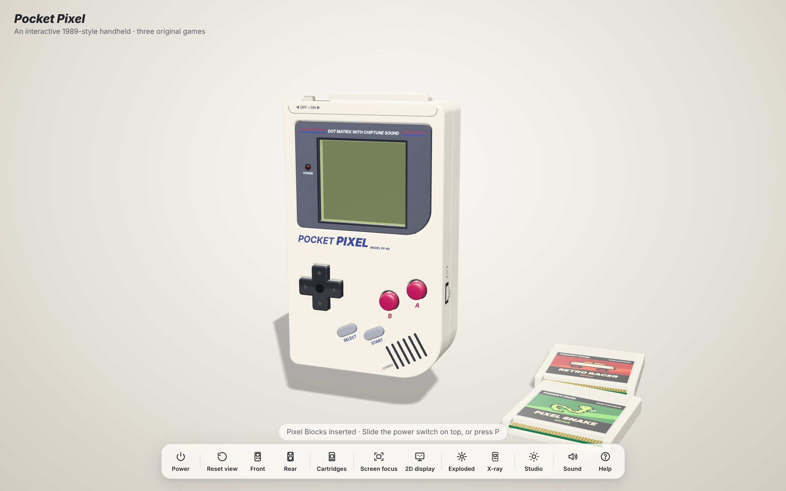
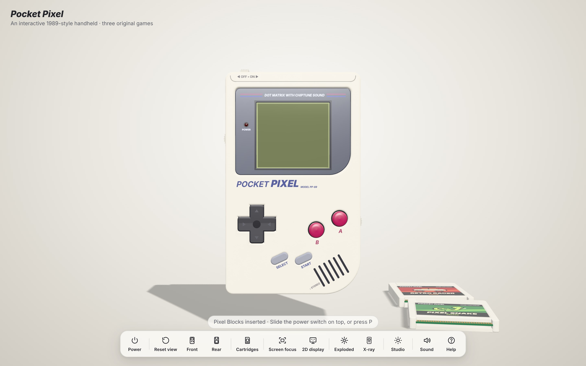
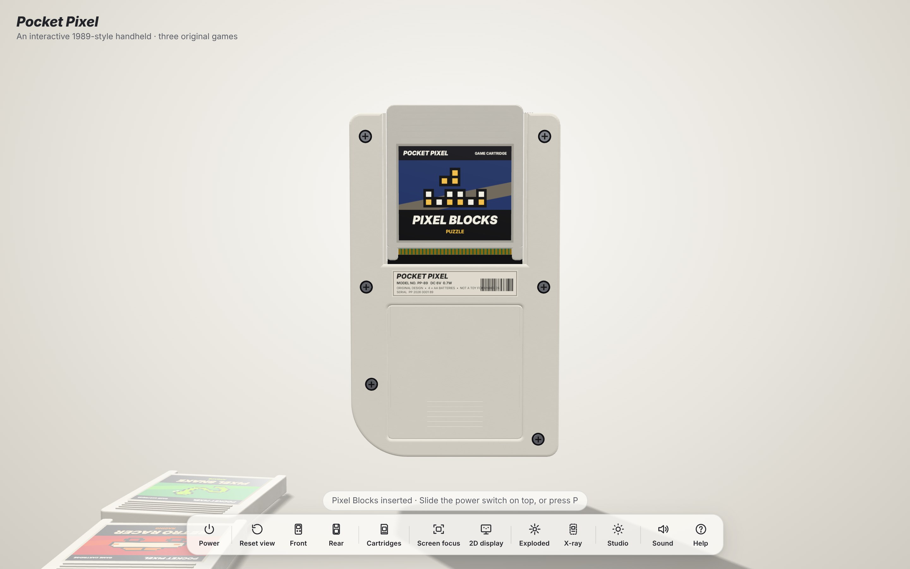
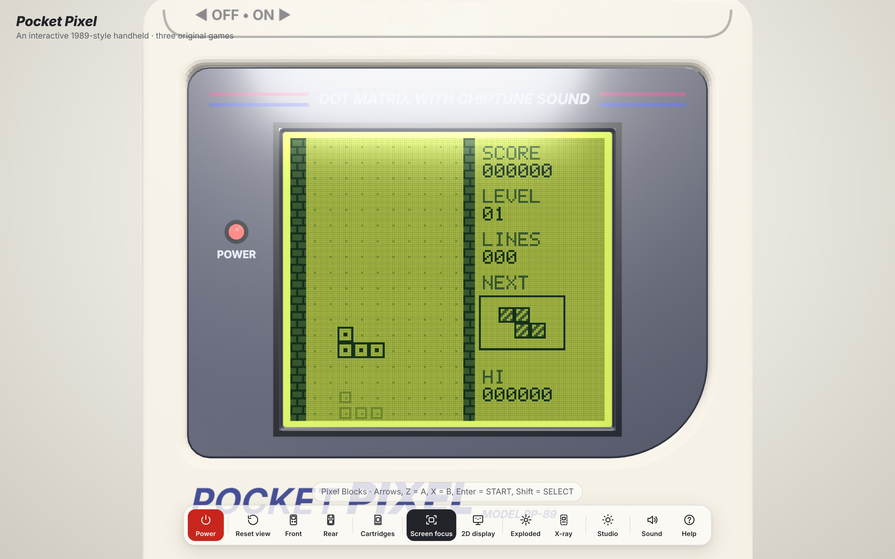
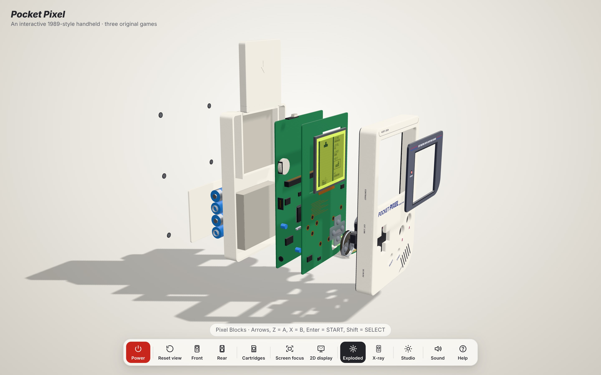
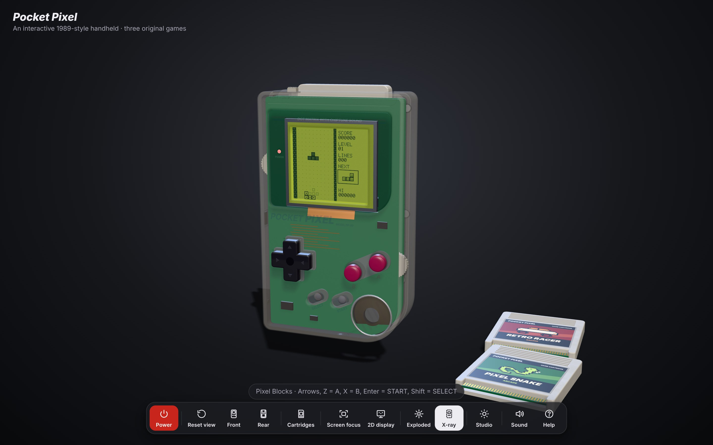
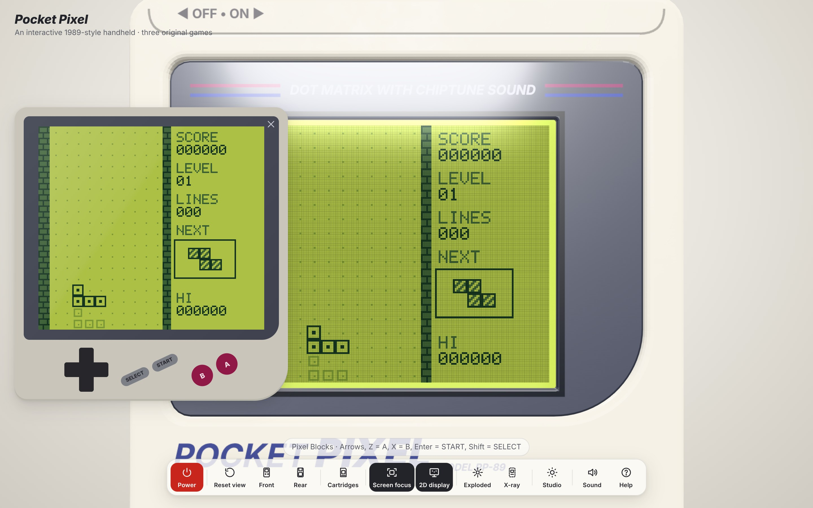

# Pocket Pixel 3D

An interactive 3D handheld console in the browser, built procedurally with Three.js. Its proportions,
layout and grey-brick styling follow the classic 1989 handheld. You can orbit it, press its buttons,
slide the power switch, turn the wheels, open the battery door and swap cartridges. Insert a
cartridge, switch on, watch the LCD boot, and play one of three original games on the working
160 × 144 four-shade screen.



| Front | Back | Playing |
|---|---|---|
|  |  |  |

| Exploded view | X-ray, dark studio | Enlarged 2D display |
|---|---|---|
|  |  |  |

Everything here is original: the "POCKET PIXEL" branding, the boot animation and chime, the games,
their pixel art, the cartridge labels, the music and the sound effects. The project contains no
third-party logos, firmware, ROMs, music or game art. There are no image or audio files at all: every
texture is drawn on a canvas at runtime, and every sound is synthesised with Web Audio.

## Running it

Requires Node 20+.

```bash
npm install
npm run dev          # http://localhost:5173
npm run build        # type-check + production build into dist/
npm run preview      # serve dist/ on http://localhost:4173
npm test             # Vitest unit tests (games, hardware, settings)
npm run e2e          # Playwright browser tests (builds, then serves on :4173)
npm run screenshots  # regenerate docs/screenshots
```

`@playwright/test` is pinned to 1.63.0. If your machine has a different Chromium build, run
`npx playwright install chromium` once, or point `PW_CHROMIUM_PATH` at an existing Chromium.

## How to play

1. Pixel Blocks is already in the slot. To pick a different game, open **Cartridges** (`L`) or click a
   cartridge lying on the table. The power must be off to change cartridges, because the power
   switch locks the cartridge in place.
2. Switch on: click the slider on the top edge, use the **Power** button, or press `P`.
3. Wait for the boot chime and the title screen, then press **START**.

### Game controls

| Keyboard | Console |
|---|---|
| Arrow keys | D-pad |
| `Z` | A |
| `X` | B |
| `Enter` | START |
| `Shift` (either) | SELECT |

The keyboard, clicks on the 3D buttons and the touch buttons in the 2D display all feed the same
button system. Holding a key or button holds it in the game, and the games auto-repeat movement while
it is held.

| Game | Controls |
|---|---|
| **Pixel Blocks**: falling-block puzzle | ←/→ move, ↓ soft drop, ↑ hard drop, A/B rotate, START pause, SELECT music on/off (title) |
| **Pixel Snake**: grid snake with timed bonus crowns | D-pad steer, hold A to dash, START pause, SELECT walls/wrap mode (title) |
| **Retro Racer**: top-down racer with traffic, fuel and lives | ←/→ steer, A accelerate, B brake, START pause, SELECT music on/off (title) |

High scores are saved in `localStorage`.

### Mouse, touch and shortcuts

- **Drag** to orbit, **scroll or pinch** to zoom toward the cursor, **right-drag** to pan.
- **Click** a part to use it and show its details: buttons press, the switch toggles, the battery
  door opens and cartridges move. **Hold** a button to keep it pressed. Press near a D-pad arm for
  that direction, or near a corner for a diagonal.
- **Drag or scroll over a thumb wheel** to turn it: volume is on the right side, contrast on the left.
- **Double-click** a part to fly the camera to it.
- Shortcuts: `P` power, `F` screen focus, `D` enlarged 2D display, `C` reset camera, `E` exploded
  view, `T` X-ray shell, `L` cartridge library, `M` mute, `H`/`?` help, `Esc` closes panels.

The **Studio** panel has four lighting presets (Studio, Dark studio, Warm showcase, Gallery spot).
It also toggles the LCD pixel grid, LCD ghosting, the glass reflection, the handheld idle motion and
slow-motion assembly, and can show a frame-rate readout.

## Features

- **Procedural model** in millimetres (90 × 148 × 32 mm).
  - Hollow front and back shells with bevelled edges and a moulding seam.
  - Recessed lens with printed stripes and caption, and a power LED.
  - Cross D-pad with arrows and a centre dimple, domed A/B buttons, angled rubber SELECT/START pills
    and an angled speaker grille.
  - Knurled volume and contrast wheels, link port, DC and headphone jacks.
  - Power slider, six screws and a model sticker.
  - Cartridge bay with an edge connector, and a battery compartment with four AA cells and springs.
- **PBR materials.** Plastic with procedural roughness and bump noise, a light clear coat and sheen.
  Button tops are worn smoother. There is reflective glass over the LCD, and the room environment map
  provides reflections.
- **Mechanics.** Button travel, D-pad tilt toward the pressed direction, the switch sliding, the wheels
  rotating and the battery door sliding then lifting. The cartridge lifts from the table, travels over
  and slides into the slot. Ejecting reverses this, and a swap waits until the old cartridge has
  cleared the slot. Pulling a locked cartridge makes it wiggle. Every animation is time-driven and can
  be interrupted: reversing one mid-way continues from where it is.
- **LCD.** 160 × 144 pixels in four green shades.
  - The contrast wheel changes the palette.
  - Slow pixel response gives ghosting.
  - An optional pixel grid.
  - The screen fades in on power-on and out on power-off.
  - The original boot animation shows a dropping logo, sparkles and a two-voice chime, then fades
    into the cartridge's title screen. With no cartridge, it blinks "NO CARTRIDGE" and waits.
- **Exploded view** with staged disassembly and reassembly, and an optional slow-motion mode. It shows
  internals: the display board with carbon contact pads, the silicone button membrane, the LCD module
  and ribbon, and the main board with the CPU (instanced pins), RAM, capacitors, crystal,
  potentiometers and cartridge connector. The speaker, batteries and springs are also visible.
- **X-ray shell**, **screen focus**, **close-up focus** on any part, **handheld idle motion**, and an
  **enlarged pixel-perfect 2D display** with touch controls. The 2D display draws from the same LCD
  canvas as the 3D screen.
- **Audio** comes from two buses. The speaker bus (game sound effects, music, boot chime) follows the
  volume wheel and is filtered like a small speaker. The mechanical bus (clicks, switch, wheel ticks,
  cartridge slide and clunk, battery door) plays at a fixed level. The audio context starts only after
  the first click or key press.

## Architecture

```
src/
  app/          main.ts (composition root), Settings (validated localStorage), DebugApi
  animation/    AnimatedValue + easing: deterministic, interruptible tweens
  hardware/     ConsoleSystem (power/boot/run state machine, fixed 60 Hz), ButtonSystem,
                PowerSystem, VolumeControl/ContrastControl, CartridgeSlot, Emitter
  display/      BootSequence (pure), LCDRenderer (palette, contrast, ghosting, grid), ScreenTexture
  games/        GameInterface (the cartridge contract), common/ (FrameBuffer, PixelFont,
                MusicNotation, AutoRepeat, Rng, ArcadeGame base, ScreenKit),
                PixelBlocks*, PixelSnake*, RetroRacer* (engine + game + audio data), registry
  audio/        AudioManager (Web Audio synth, pulse waves, noise drums, lookahead sequencer)
  models/       GameBoyModel, CartridgeModel/CartridgeRig, InternalComponents, Materials,
                PrintTextures, Shapes, Layout (all dimensions), BodyOutline
  scene/        SceneManager (renderer + loop), CameraController (orbit + flights), LightingManager
  interaction/  InputManager (keyboard), InteractionController (raycast, hold, drag, wheel, focus)
  ui/           Toolbar, InfoPanel, CartridgeLibrary, StudioPanel, HelpDialog, ScreenOverlay, Toast
tests/
  unit/         Vitest: games (rules, rendering, music parsing), hardware, settings, tweens
  e2e/          Playwright: boot + play by keyboard, 3D clicks, wheel scroll, cartridge lock, views
```

**Boundaries.** `games/` imports nothing outside itself and has no Three.js, DOM or Web Audio code. It
is deterministic: games tick at a fixed 60 Hz and all randomness is injected. `hardware/` and
`display/BootSequence` are pure as well. `ui/` never imports Three.js: the label art and lighting
preset data it needs live in canvas-only modules (`display/LabelArt`, `scene/LightingPresets`).
Three.js is used by `models/`, `scene/`, `display/ScreenTexture`, the raycasting in
`interaction/InteractionController` and the composition root `app/main.ts`.

**Data flow.**

1. Keyboard, 3D pointer and touch input all go into `ButtonSystem`.
2. `ConsoleSystem` runs fixed ticks and drives either the boot sequence or the game.
3. That fills the shared `FrameBuffer`.
4. `LCDRenderer` turns the framebuffer into a 160 × 144 canvas. The 3D screen texture (4× with the
   pixel grid baked in) and the 2D display both read from that canvas.

Sound flows the same way. Games describe sound effects and music as data (`SfxSpec`, `MusicTrack`
note strings), and `AudioManager` synthesises them.

**Adding a cartridge.** Implement `Game` and export a `CartridgeDefinition` from `src/games/`. The
definition carries the title, description, controls, a label (colours plus pixel-art rows) and
`create(services)`. Then add it to `registry.ts`. The table cartridge, its label, the library card
and its high score all appear automatically. `ArcadeGame` already handles the title, pause and
game-over flow.

**Performance.**
- Every texture is generated once.
- The screen texture is only uploaded when the LCD actually changes.
- IC pins and edge-connector contacts are instanced.
- Internal parts are hidden unless the model is exploded or in X-ray mode.
- The render loop keeps scratch vectors around instead of allocating new ones each frame.
- The Studio panel's frame-rate readout also shows draw calls (about 110–130 in the normal view).
- All Three.js geometries, materials and textures are disposed on hot reload.

On the dev server, or in any build opened with `?debug` in the URL, `window.pocketPixel` exposes a
small API for tinkering and tests: `state()`, `step(n)`, `press(b)`,
`release(b)`, `power()`, `cartridge(id)`, `view(name)`, `exploded(on)`, `xray(on)`, `screenPoint(part)`
and a few more (see `src/app/DebugApi.ts`).

## Testing notes

- `npm test` runs more than 100 unit tests. They cover the game engines (collisions, rotation kicks,
  line clears, scoring, growth, wrap mode, fuel, crashes), 600-tick render runs for each game, music
  parsing, the console state machine (boot, chime, cartridge lock, sound gating, fixed timestep),
  button edges and latching, wheels, tweens and settings validation.
- `npm run e2e` drives the built app in Chromium:
  - keyboard play
  - clicking the real 3D power switch and holding the 3D A button (through the raycaster)
  - scrolling the volume wheel
  - the cartridge lock and swap
  - the exploded and X-ray views
  - the 2D display's touch START button

  Each test also fails if the browser logs a console error. The tests advance the console with
  `step(n)` so they don't depend on the frame rate.
- Headless Chromium renders with SwiftShader (software GL) at roughly 3–10 fps. That speed says
  nothing about real hardware, so measure frame rate on a GPU with the Studio panel's readout.

## Known limitations and future ideas

- The link port, DC jack and headphone jack are decorative.
- Text printed on the shell uses the system sans-serif font, so it varies a little between
  operating systems.
- The audio is a stylised chiptune synth, not an emulation of any real sound hardware.
- Ideas for later:
  - two-player link-cable games between two browser tabs
  - more cartridges, such as a puzzle-platformer
  - shell colour variants
  - an outline highlight on hover
  - baked ambient-occlusion maps
  - WebXR viewing
