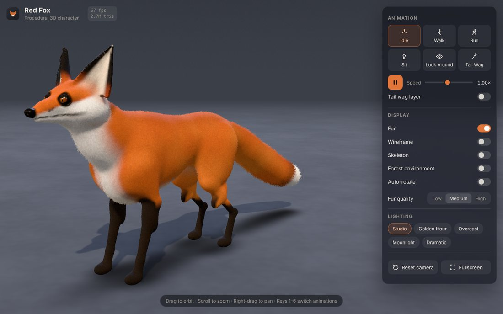
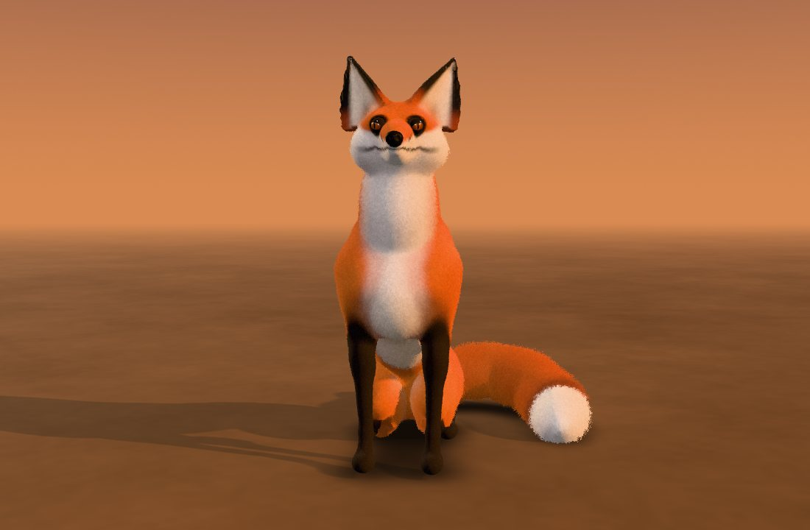
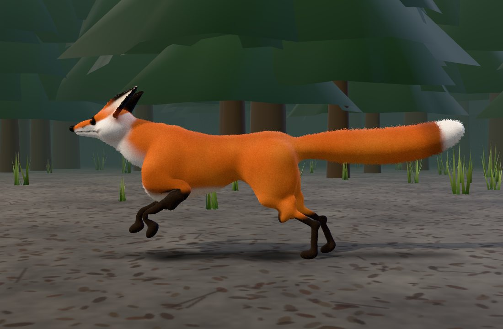
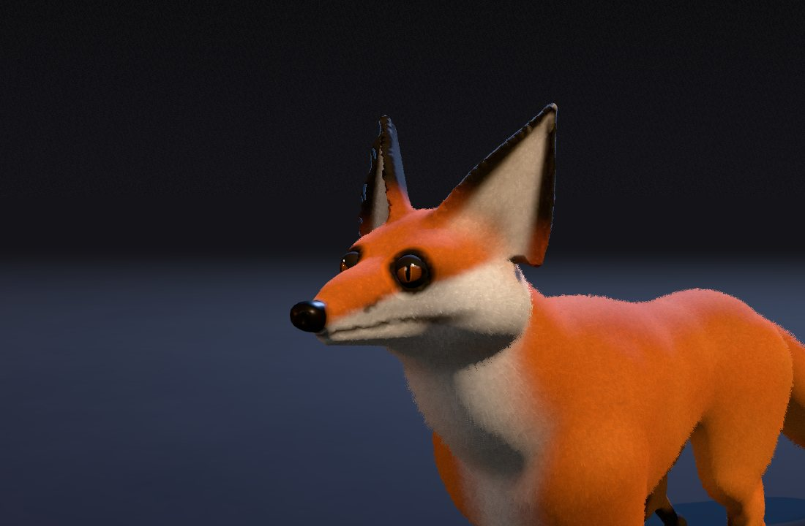
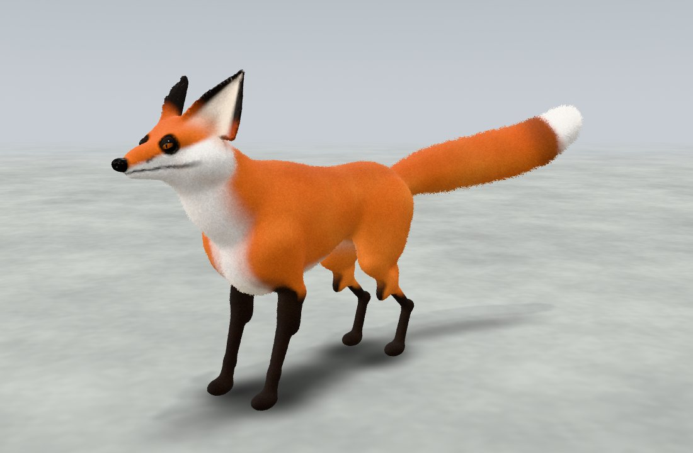

# Red Fox

A fully procedural, animated 3D red fox that runs in the browser. Everything you see is generated in
code when the page loads: the body is sculpted from signed distance fields and meshed on the fly, the
coat is painted per vertex, the fur is rendered with shell shading, and every animation is procedural
and driven by a hierarchical skeleton with leg IK. There are no downloaded models, no texture files
and no paid assets.



| | |
|---|---|
|  |  |
|  |  |

## Technology

- **Three.js 0.186** (WebGL 2) and **TypeScript 5.9** in strict mode
- **Vite 8** for the dev server and production build; the mesh is built in a **Web Worker**
- **Vitest** for unit tests
- No runtime dependencies other than `three`

## Build and run

Requires Node.js 22.12 or newer.

```bash
npm install
npm run dev        # http://localhost:5173
```

Other commands (run from this `RedFox/` folder):

```bash
npm test           # unit tests (Vitest)
npm run typecheck  # tsc --noEmit
npm run build      # type-check, then production build into dist/
npm run preview    # serve the production build on http://localhost:4173
```

`dist/` is a static site; serve it from any static host. It uses relative paths, so it also works from
a sub-folder. (`.npmrc` sets `legacy-peer-deps`, which works around an npm 10 bug with Vitest's
optional peer dependencies.)

## Controls

| Input | Action |
|---|---|
| Drag / one finger | Orbit around the fox |
| Scroll / pinch | Zoom |
| Right-drag / two fingers | Pan |
| `1`–`6` | Idle, Walk, Run, Sit, Look Around, Tail Wag |
| `Space` | Play / pause |
| `H` / `W` / `K` | Fur, wireframe, skeleton |
| `E` / `A` | Forest environment, auto-rotate |
| `R` / `F` | Reset camera, fullscreen |

The panel also has a playback speed slider (0.1×–2×), an additive **tail wag layer** that works on
top of any animation, fur quality (low / medium / high), and five lighting presets: Studio, Golden
Hour, Overcast, Moonlight and Dramatic. On phones the panel becomes a bottom sheet.

## Features

### Character

- One closed, smooth mesh (about 65k vertices / 130k triangles on desktop) with no seams between
  body parts, so nothing separates when it animates.
- Anatomy built from about 70 blended primitives: deep chest and tucked waist, long narrow muzzle,
  black nose with nostrils, large cupped ears with hollow inner surfaces, four articulated legs with
  shoulder blades, hocks and paws, and a thick tail plume that follows a spline.
- Amber eyes with vertical slit pupils, clear-coat highlights, a fixed catch-light, black-rimmed
  almond lids that blink, and small gaze darts.
- Coat painted from anatomical masks: orange-red with a darker saddle, white muzzle, cheeks, throat
  and chest, cream belly, black "stockings" and paws, black-backed ears with cream insides, dark tear
  streaks, a mouth line, a grizzled tail and a white tail tip.

### Fur

- Shell fur: up to 28 copies of the skinned body pushed out along the skinned normals. All shells share
  one geometry and skeleton; only a small material per shell differs.
- Each fragment tests whether it lies inside a hair using 3D cellular noise in rest-pose space, so
  hairs stick to the body while it moves. Hairs taper, vary in length and tone, clump, and get
  dark guard-hair tips on the back and tail. A dense underfur fills the gaps near the skin.
- Fur length varies by region: short on the face, legs and ears, longer on the cheek ruff, chest bib
  and thighs, longest on the tail. Fur leans along an anatomical comb direction, droops under gravity,
  sways gently, and streams back when the fox runs.
- Lit with the physically based `MeshPhysicalMaterial` (sheen tinted by the coat, softened specular),
  with self-shadowing toward the roots. Alpha-to-coverage gives soft hair edges with MSAA.

### Animation

- A 39-bone skeleton: spine, ribcage (for breathing), neck, head, ears, shoulder blades, two-segment
  legs with metacarpus/metatarsus and toes, and a six-bone tail.
- Six procedural states: **Idle** (breathing, blinking, ear twitches, weight shifts), **Walk** (lateral
  sequence walk), **Run** (rotary gallop with spinal flex and bounce), **Sit** (staged transition: rump,
  then chest, then the tail wraps around the paws), **Look Around** (eyes lead, head follows, ears
  swivel independently, a sniff), and **Tail Wag**.
- Poses are parametric: legs are goals (paw position, lower-segment pitch, toe pitch, knee pole) solved
  with analytic two-bone IK plus a swinging shoulder blade, so paws stay planted and blends between
  states (for example stand to sit) stay anatomically plausible.
- Smooth crossfades between any states, an additive tail-wag layer, spring-damper tail dynamics driven
  by the hips' motion, and a ground clamp that keeps the tail off the floor.

### Viewer and environment

- Orbit, zoom and pan; animated camera reset; fullscreen; auto-rotate; FPS and triangle counter.
- Seamless studio backdrop (the ground fades into the gradient through fog), contact shadows plus a
  soft shadow-mapped key light, three-point lighting, image-based reflections, neutral tone mapping.
- Optional forest: instanced pines, rocks and grass tufts, leaf-litter ground, misty fog. The ground
  and forest scroll at exactly the fox's speed while it walks or runs in place.
- Responsive: portrait screens pull the camera back to fit, the panel turns into a bottom sheet, and
  phones get a lighter mesh and fewer fur shells.

## How it works

```
src/
├── main.ts                   Entry point; disposes everything on Vite hot reload
├── App.ts                    Wires viewer, environment, fox, animation and UI; URL parameters
├── core/Viewer.ts            Renderer, camera, OrbitControls, frame loop, resize, camera tween
├── fox/
│   ├── sdf/primitives.ts     Ellipsoid, round cone, sphere and cupped-ear SDFs; smooth min/max
│   ├── sdf/SdfModel.ts       Ordered smooth blend of parts, plus a uniform-grid accelerator
│   ├── sdf/surfaceNets.ts    Surface Nets mesher with coarse empty-space skipping
│   ├── anatomy.ts            Skeleton (rest pose) and the sculpt: every body part and its bone
│   ├── coat.ts               Colour, fur length, comb direction and roughness per vertex
│   ├── FoxBuilder.ts         Mesh, surface projection, normals, skin weights, coat (pure, no DOM)
│   ├── foxWorker.ts          Runs FoxBuilder in a Web Worker; loadFox.ts is the main-thread side
│   ├── FurMaterial.ts        Skin and shell materials (shader injection into MeshPhysicalMaterial)
│   ├── Eyes.ts               Eyeballs, procedural iris texture, lids and catch-lights
│   └── FoxModel.ts           Skeleton, skinned body, fur shells and eyes as Three.js objects
├── animation/
│   ├── Pose.ts               Parametric pose (rotations, leg goals, tail aim, face channels) + blend
│   ├── states.ts             The six procedural animation states
│   ├── ik.ts                 Analytic two-bone IK
│   ├── FoxRig.ts             Applies poses: IK, breathing, blinks, ears, eyes, tail springs
│   └── AnimationController.ts  Crossfading state machine
├── environment/              Studio backdrop and lights, presets, contact shadows, forest
└── ui/ControlPanel.ts        Dark glass control panel and keyboard shortcuts
tests/                        Vitest: SDFs, mesher output, IK, poses and gaits
```

**Building the mesh.** `anatomy.ts` describes the fox as about 70 primitives, each owned by a bone and
blended into the parts before it with a polynomial smooth minimum. `surfaceNets.ts` samples the field on
a 3.6 mm grid; a coarse pass skips empty space, so only blocks near the surface are sampled finely.
Vertices are then projected onto the exact surface with Newton steps and get normals from the field
gradient. A uniform grid lists only the parts near each cell, which halves the build time (about 2–3.5 s
in the worker, with a progress bar).

**Skinning and coat.** For each vertex, every bone gets the distance to its own (unblended) parts;
weights fall off smoothly with the distance above the nearest bone, so joints bend smoothly where the
shapes were blended. The same per-bone weights, the vertex position and normal, and per-part
distances (for creases such as the mouth line) drive the coat masks.

**Fur.** Shells are skinned like the body. The vertex shader skins the comb direction with the same
skin matrix as the normal, then offsets each shell along the normal plus a quadratic bend (comb,
gravity, wind, sway). The fragment shader does the hair test described above.

**Animation.** Each state writes a full `Pose` for its own time. The controller blends all active
poses by eased weights (slerp for rotations, lerp for leg goals), and `FoxRig` applies the result:
posed rotations, then leg IK in world space, then the procedural layers. Time is scaled by the speed
slider, and pausing freezes everything except the camera.

**Resources.** Every class that creates GPU resources has a `dispose()`. `App.dispose()` releases the
fox, environment, render targets, textures and the renderer, and runs automatically on Vite hot
reload.

### URL parameters

Handy for screenshots and debugging: `anim=idle|walk|run|sit|look|wag`, `t=<seconds>` (pre-roll),
`preset=studio|golden|overcast|moonlight|dramatic`, `forest=1`, `fur=0`, `wire=1`,
`quality=low|medium|high` (also turns off adaptive quality), `cam=side|front|back|head|headfront|top|low`,
`pause=1`, `ui=0`. With `shot=1` the frame loop does not start and tests drive frames through
`window.__fox.step(frames)` and `window.__fox.capture()`.

## Performance

- The mesh is built once, in a worker, so the page stays responsive while it loads.
- Fur cost scales with the number of shells: 10 (low), 18 (medium), 28 (high). Desktop starts on high,
  phones on low. Unless you choose a level yourself, the viewer measures the frame rate after start-up
  and steps down a level if it is below 40 fps.
- The loop does no per-frame allocation in the animation path, clamps long frames, and pauses
  timekeeping while the tab is hidden. Pixel ratio is capped at 2 (1.75 on touch devices).

## Verification

Run for this version:

- `npm run typecheck` and `npm test`: clean, 17 tests passing (SDF primitives, accelerator equivalence,
  mesh closed and weights normalised, two-bone IK, pose blending, every state finite with paws above
  ground, walk stance paws sliding at exactly ground speed, sit settling).
- `npm run build`: production bundle (about 166 kB gzipped JS plus a 23 kB worker), served with
  `vite preview` and loaded in headless Chromium with no console errors or warnings.
- A browser smoke test clicked every animation, toggle, lighting preset, quality level, play/pause,
  the speed slider, camera reset and the keyboard shortcuts with no console errors.
- Visual review from many angles and in every animation with headless screenshots (the images above).

## Limitations and possible improvements

- **Fur is shell-based.** It looks soft at normal viewing distances, but very close up or at grazing
  angles you can see the layers. Fins on the silhouette, or instanced guard hairs on the tail, would
  hide that.
- **Locomotion is in place.** The fox walks and runs on a treadmill (the ground scrolls under it); it
  does not steer or turn. Root motion along a path with turning gaits would be a natural next step.
- **No mouth animation.** The jaw is sculpted closed; panting, yawning or vocalising would need a jaw
  bone and an inner mouth.
- **Contact with the ground is approximate.** Paws are planted by IK on flat ground only, and the tail
  is clamped above the floor but not collided with the legs, so it can graze a thigh in extreme poses.
- **Shading model.** The fur uses a physically based surface model with sheen rather than a dedicated
  hair model (for example Kajiya-Kay or Marschner), so there is no anisotropic highlight.
- **The forest is simple.** It is stylised instanced geometry meant to sit behind fog, not a detailed
  environment.
- **Testing in this environment.** It was verified in headless Chromium with software rendering
  (SwiftShader), which says nothing about frame rate on real GPUs; adaptive quality covers slower
  devices.
