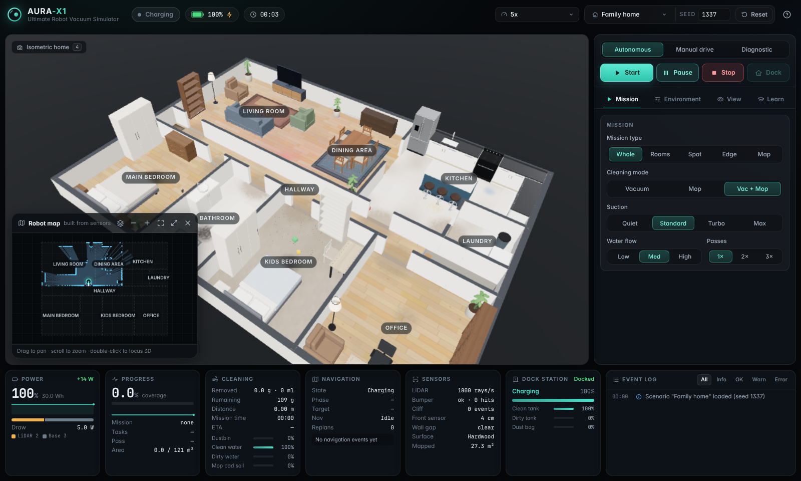

# Ultimate Robot Vacuum: 3D autonomous cleaning simulator

An interactive digital twin of an original, futuristic robot vacuum (**AURA-X1**), its
multifunction docking station and a furnished multi-room home. The robot is driven by a real
(simplified) robotics stack running in the browser:

- LiDAR and occupancy mapping
- frontier exploration
- A\* planning on an inflated costmap
- boustrophedon coverage with wall-following edge cleaning
- dynamic replanning and stuck recovery
- battery- and resource-aware return, recharge and resume

Cleaning is simulated too: spatial dirt that vacuuming and mopping remove pass by pass.



## Quick start

Requires Node 20+ (tested with Node 22).

```bash
cd RoboVacSim
npm install
npm run dev          # http://localhost:5173
```

Production build: `npm run build && npm run preview`.

## What you can do

| Area | Features |
|---|---|
| **Missions** | Start / Pause / Resume / Stop / Return to dock; whole house, selected rooms, spot, edge-only, initial mapping; Vacuum / Mop / Vacuum + Mop; suction Quiet–Max and water Low–High (both adjustable live); 1–3 passes (pass 2 runs cross-hatched) |
| **Modes** | Autonomous; manual drive (WASD/arrows, Space toggles vacuum, mapping and safety reflexes stay on); diagnostic self-test (9 checks) |
| **Simulation speed** | 0.5×, 1×, 2×, 5×, 10× (and 20× fast-forward); all systems run on simulated time |
| **Environment editing** | Move and rotate furniture; add or remove obstacles and furniture; drop an obstacle onto the robot's live path; spill dust, crumbs, hair, liquid or stains; draw no-go and no-mop zones; change a room's floor type; wall visibility full / cutaway / hidden; presets (Simple apartment, Family home, Obstacle challenge) with a seed and Reset |
| **Robot** | Spinning LiDAR, bumper travel, wheels driven by odometry, caster swivel, side and main brushes, lowering and rotating mop pads, suspension, dustbin lid, LED ring states, suction particles; exploded view, x-ray, clickable inspection of 23 components |
| **Dock** | Self-empty with a particle stream, mop wash, water exchange, hot-air drying, status display; removable panels, cutaway, 17 inspectable parts |
| **Visualisation** | LiDAR point cloud and rays, robot costmap, planned path, remaining lanes, trajectory, dirt (realistic or heatmap), coverage tint, zones, sensor cones, room labels |
| **Dashboard** | Live telemetry (battery and power breakdown, coverage, area, dirt removed, distance, mission time and ETA, dustbin, water, state, navigation target, sensors, dock); interactive 2D occupancy map; event log; perf overlay |
| **Cameras** | Orbit robot, Follow, Top-down plan, Isometric home, Robot camera, LiDAR view, Dock close-up, Exploded robot, Cutaway (keys 1–9), all with smooth transitions plus orbit, pan and zoom |
| **Learn** | Engineering mode covering differential drive, LiDAR, occupancy mapping, A\*, coverage paths, cliff sensors, docking, suction and brushes, and mop washing. Each topic has step-through explanations, live values and in-scene callouts. Simplified models are labelled as such. |
| **Quality** | Low / Medium / High / Ultra presets, plus an adaptive governor that lowers the render scale if the frame rate drops |

## Controls

- **Mouse:**
  - Left-drag to orbit, right-drag to pan, wheel to zoom.
  - With an editor tool active, the left button belongs to the tool and the camera orbits with the
    right button.
- **Keyboard:**

  | Key | Action |
  |---|---|
  | Space | Pause / resume |
  | 1–9 | Camera modes |
  | M | Manual drive |
  | WASD / arrows | Drive (in manual mode) |
  | Esc | Cancel tool / selection |
  | Delete | Remove selection |
  | R / Shift+R | Rotate selection |
  | H | Help |

- **2D map:**
  - Click a room to select it (for a Selected-rooms mission).
  - Pick a spot for spot cleaning.
  - Double-click to focus the 3D camera.

## Tips for a demo

1. **Family home** at 10× or 20×, then **Start** (Whole, Vac + Mop). Watch the robot:
   1. undock,
   2. explore the house (frontiers),
   3. clean the edges, then lanes,
   4. refill water or recharge mid-mission and **resume** where it stopped,
   5. return and run the dock service cycle.
2. **Environment → Drop obstacle on path** while the robot is driving. It detects the obstacle and
   replans around it.
3. **Environment → Demo battery → 18 %** during cleaning to trigger low battery → dock → charge → resume.
4. Camera **Exploded robot** (key 8), then click components to read what they do.
5. **Learn** tab → pick a topic → **Show me**.

## Project layout

```
src/sim/      pure TypeScript simulation (no DOM/three): world, robot, sensors, mapping,
              navigation, cleaning, resources, dock, mission FSM, Simulation, telemetry
src/render/   Three.js: Stage, CameraRig, HouseView, robot/dock models, overlays, editor, WorldView
src/app/      AppController (loop + lifecycle), zustand store, AppApi, React provider
src/ui/       React dashboard, 2D map, education content
tests/unit/   Vitest: algorithms, state machine, resources, acceptance scenarios (headless)
tests/e2e/    Playwright browser tests (+ screenshots in docs/screenshots)
dev/          standalone preview pages for the 3D models and house presets
```

## Documentation

- [ARCHITECTURE.md](ARCHITECTURE.md): layers, module responsibilities, data flow, performance and lifecycle
- [ROBOTICS.md](ROBOTICS.md): algorithms, models and every simplification
- [TESTING.md](TESTING.md): automated and manual tests with results
- [PHASES.md](PHASES.md): milestones, completion criteria, status, evidence, open issues

## Scripts

| Script | Purpose |
|---|---|
| `npm run dev` | Vite dev server |
| `npm run build` | type check + production bundle |
| `npm run preview` | serve the production build |
| `npm test` | Vitest unit, integration and acceptance tests |
| `npm run e2e` | Playwright browser tests (run `npm run build` first) |
| `npm run lint` / `npm run typecheck` | ESLint / tsc |
| `npm run check` | typecheck + lint + tests |

No backend, API keys or proprietary assets: every model and texture is generated procedurally.
